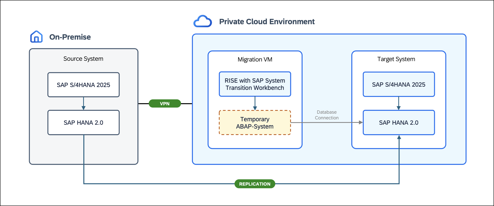

# TM263 - AI-accelerated RISE with SAP migration with the system transition workbench

## Overview

This hands-on session shows how to perform a <b>homogeneous SAP S/4HANA migration</b> to <b>RISE with SAP</b> using the <b>RISE with SAP System Transition Workbench</b>. You will perform a guided <b>lift-and-shift sandbox migration</b> of an <b>SAP S/4HANA FOUNDATION 2025 FPS01</b> system to the <b>Private Cloud Environment</b>, with <b>SAP HANA tenant replication</b> as the technical migration approach.
 

  

Using the <b>RISE with SAP System Transition Workbench</b>, you will <b>check migration prerequisites</b>, <b>prepare the required software</b>, and <b>establish SAP HANA replication</b> before completing <b>downtime processing</b>, <b>post-processing</b>, and the <b>final application switchover</b>. Along the way, you will document key migration milestones and validate data continuity on the target system. At selected points throughout the migration, you will use <b>Joule for Consultants</b> with a dedicated <b>Migration Expert</b> to gain additional technical insights and support troubleshooting.
 

## Requirements
To complete the exercises in this hands-on session, you need **SAP GUI** and a **web browser** (preferably **Google Chrome**).  

## Exercises

Building on the <b>preconfigured landscape</b>, the exercises guide you through the migration, combining guided tasks in the <b>RISE with SAP System Transition Workbench</b> with manual activities in the SAP systems. Step by step, you will execute the migration, document key milestones, and validate the results on the target system.

Below you find an overview of all exercises included in this hands-on session:

- [Getting Started: Scenario Overview & Hands-On Setup](exercises/ex0/)
- [Exercise 1 - Initiate the Transition: Check Prerequisites](exercises/ex1/)
- [Exercise 2 - Prepare the Transition: Download Software](exercises/ex2/)
- [Exercise 3 - Establish Replication: Prepare & Replicate SAP HANA](exercises/ex3/)
- [Exercise 4 - Finalize the Tenant Copy](exercises/ex4/)
- [Exercise 5 - Complete Migration Post-Processing](exercises/ex5/)
- [Exercise 6 - Switch to the Main Instance](exercises/ex6/)

 

## Contributing
Please read the [CONTRIBUTING.md](./CONTRIBUTING.md) to understand the contribution guidelines.  

## Code of Conduct
Please read the [SAP Open Source Code of Conduct](https://github.com/SAP-samples/.github/blob/main/CODE_OF_CONDUCT.md).  

## How to obtain support
Support for the content in this repository is available during the actual time of the online session for which this content has been designed. Otherwise, you may request support via the [Issues](../../issues) tab.  

## License
Copyright (c) 2026 SAP SE or an SAP affiliate company and teched2026-TM263 contributors. Please see our [LICENSE](LICENSE) for copyright and license information. Detailed information including third-party components and their licensing/copyright information is available [via the REUSE tool](https://api.reuse.software/info/github.com/SAP-samples/teched2026-TM263).
