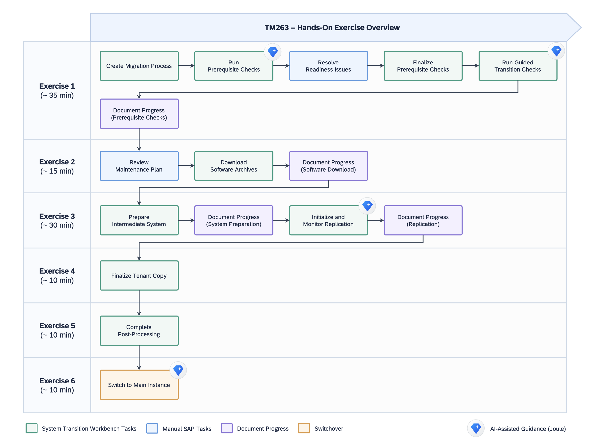
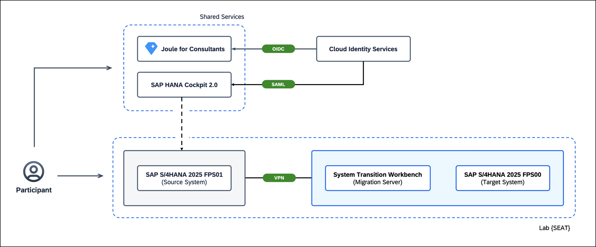

# Getting Started: Scenario Overview & Hands-On Setup

In this overview, you will explore the <b>migration scenario</b>, the <b>system landscape</b>, and the <b>exercise journey</b> for this hands-on session. You will also review the preconfigured environment and learn how to access your assigned lab systems before starting the hands-on activities.
 

## Customer Situation

In this hands-on session, you will work with the fictional company <b>CONSAREA Inc.</b>, a global manufacturer and distributor of premium pencils. CONSAREA is currently running on <b>SAP S/4HANA FOUNDATION 2025 FPS01</b> and has decided to migrate its SAP landscape to <b>RISE with SAP</b> in the <b>Private Cloud Environment</b>.

Like many real-world enterprises, CONSAREA aims to modernize its SAP landscape while minimizing business disruption and reducing migration risks. To support this transition, the company has engaged <b>CONSAREA Services</b>, a subsidiary of CONSAREA Inc., as its <b>migration partner</b>. Together, they have chosen the <b>RISE with SAP System Transition Workbench</b> as a guided approach to managing and executing the migration process.

Before migrating business-critical systems, CONSAREA has decided to validate its <b>lift-and-shift approach</b> through an <b>initial sandbox migration based on a homogeneous SAP HANA tenant copy</b>. This allows the migration team to become familiar with the process, validate the technical steps, and gain confidence in the transition approach.

The following diagram illustrates the high-level migration setup. The <b>RISE with SAP System Transition Workbench</b> orchestrates the migration process and installs a <b>temporary ABAP system</b> on the <b>Migration VM</b>. While <b>SAP HANA tenant replication</b> replicates data from the source to the target database, the temporary system remains inactive. Once the tenant copy is finalized, it connects to the <b>target SAP HANA database</b> to perform post-processing activities before the final switch to the <b>Main Instance</b>.
 

  

Throughout this hands-on session, you will take the role of a member of CONSAREA Services' migration team and guide the sandbox system through the migration journey, from initial preparation and replication to the final application switchover and validation of data continuity.
 

## TM263 at a Glance

Using the <b>RISE with SAP System Transition Workbench</b> and a <b>preconfigured hands-on landscape</b>, you will experience the end-to-end migration process, starting with <b>prerequisite checks</b> and <b>software preparation</b>, followed by <b>SAP HANA tenant replication</b>, <b>downtime processing</b>, and the <b>final application switchover</b>. Along the way, you will document migration milestones and validate <b>data continuity</b> on the target system.

Below you will find an overview of all six exercises and their corresponding migration phases. The <b>Joule for Consultants</b> icons highlight selected activities where a dedicated <b>Migration Expert</b> provides AI-assisted technical guidance.
 

   

## Landscape Overview

The following diagram illustrates the <b>hands-on system landscape</b> and the shared services used throughout this session.

Each participant works in a <b>dedicated lab environment</b> consisting of a <b>Source System</b> running <b>SAP S/4HANA FOUNDATION 2025 FPS01</b>, a <b>Migration Server</b> hosting the <b>RISE with SAP System Transition Workbench</b>, and a <b>Target System</b> based on <b>SAP S/4HANA FOUNDATION 2025 FPS00</b> (Skeleton System).

Shared services include <b>SAP HANA Cockpit</b> for database administration and <b>Joule for Consultants</b> for AI-assisted migration guidance. <b>SAP Cloud Identity Services</b> enables <b>Single Sign-On (SSO)</b> for these applications.
 

   

## Access Your Lab Environment

Each participant has been assigned a <b>dedicated SAP landscape</b> consisting of a source system, a target system, and a migration server. To simplify access, we have prepared an individual <b>connection package</b> containing browser links and SAP GUI connection files.

Follow these steps to set up access to your assigned lab systems: 
1.  Identify your assigned three-digit lab number (for example, `001`). 
2.  Navigate to the [resources](../../resources/) directory and select the folder matching your lab number. 

    > **💡 TIP**: To open this link in a new tab, **right-click** and choose **Open Link in New Tab**.

3.  Download **TM263_SystemDetails.zip** and extract it to a local folder. 
4.  Use the provided **SAP GUI connection** files and **browser links** to access your assigned systems.   

## Further Links

If you would like to explore more about the concepts and tools used in this hands-on session, refer to the following resources:

> **💡 TIP**: To open the links in a new tab, **right-click** and choose **Open Link in New Tab**.

- [SAP Support: RISE with SAP System Transition Workbench](https://support.sap.com/en/tools/software-logistics-tools/rise-with-sap-system-transition-workbench.html)
- [SAP Help Portal: RISE with SAP System Transition Workbench](https://help.sap.com/docs/rise-system-transition/workbench/about-rise-with-sap-system-transition-workbench?version=SHIP)
- [SAP Help Portal: Homogeneous System Copy Including SAP HANA Tenant Copy or Move](https://help.sap.com/docs/SLTOOLSET/940e4b48bd434bcb95db32940d08694f/8d7cab17005046659feea9dc6a1b425e.html)
- [SAP Help Portal: SAP Joule for Consultants](https://help.sap.com/docs/joule/serviceguide/sap-consulting-capability-for-joule)
- [SAP for Me: RISE with SAP System Transition Workbench (Note 3462243)](https://me.sap.com/notes/3462243)
- [Blog: Introducing the RISE with SAP System Transition Workbench](https://community.sap.com/t5/technology-blog-posts-by-sap/introducing-the-rise-with-sap-system-transition-workbench/ba-p/14130250)
- [Blog: RISE with SAP System Transition Workbench: Expanded Migration Approaches](https://community.sap.com/t5/technology-blog-posts-by-sap/rise-with-sap-system-transition-workbench-expanded-migration-approaches/ba-p/14456436)

 

## Summary

You have now gained an understanding of the <b>SAP S/4HANA sandbox migration scenario</b>, reviewed the <b>exercise journey</b> and the <b>preconfigured system landscape</b>, and set up <b>access to your assigned lab systems</b>. Everything is now ready to begin <b>Exercise 1</b> with the initial migration preparation and <b>prerequisite checks</b>.

Continue to [Exercise 1 - Initiate the Transition: Check Prerequisites](../ex1/README.md)