# Exercise 1 - Initiate the Transition: Check Prerequisites
<p align="justify">In this exercise, you will initiate the transition process for an SAP HANA tenant copy using the <b>RISE with SAP System Transition Workbench</b>, validate migration readiness, and resolve prerequisite findings in the source system. You will then record a milestone in an SAP Fiori application while the source system is still available during the <b>Uptime</b> phase.</p>

This exercise consists of the following sub-exercises:
- [Exercise 1.1 - Access RISE with SAP System Transition Workbench](#exercise-11---access-rise-with-sap-system-transition-workbench)
- [Exercise 1.2 - Start Prerequisite Checks](#exercise-12---start-prerequisite-checks)
- [Exercise 1.3 - Verify SAP HANA Configuration](#exercise-13---verify-sap-hana-configuration)
- [Exercise 1.4 - Continue Prerequisite Checks](#exercise-14---continue-prerequisite-checks)
- [Exercise 1.5 - Perform Guided Transition Checks](#exercise-15---perform-guided-transition-checks)
- [Exercise 1.6 - Document Progress on the Source System](#exercise-16---document-progress-on-the-source-system)

<br>

## Exercise 1.1 - Access RISE with SAP System Transition Workbench
<p align="justify">In this sub-exercise, you will access the <b>RISE with SAP System Transition Workbench</b>, create a new SAP HANA tenant copy process, select the preconfigured vault, and familiarize yourself with the <b>Uptime</b> and <b>Downtime</b> phases.</p>

Follow these steps to complete the exercise:<br>
1.  Open the **RISE with SAP System Transition Workbench** using the `transition-workbench.url` shortcut included in your connection package.<br>
2.  Log on as **sapadm** with the **master password** provided for your hands-on session.<br><br>
    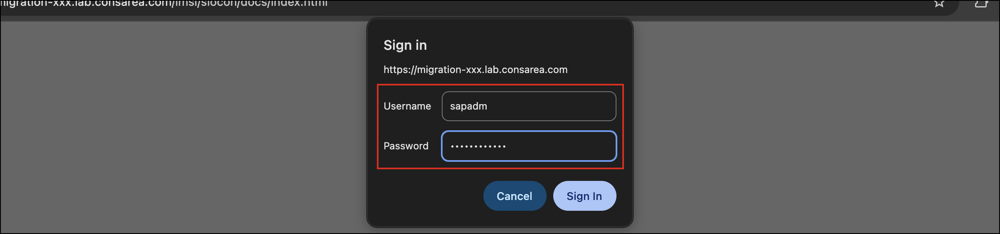<br>

3.  Under **Active Procedures**, choose **Create**.<br><br>
    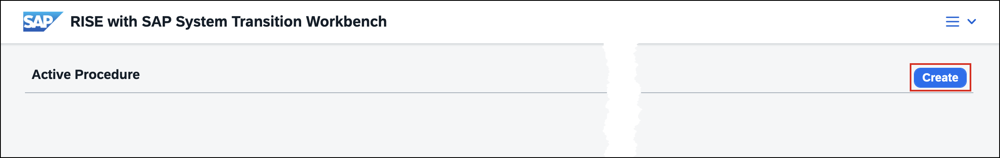<br>

4.  In the **Create a new process** dialog, navigate through the following catalog entries:<br>
    - **RISE with SAP System Transition Workbench for SAP S/4HANA Cloud Private Edition**
    - **Homogeneous System Copy Including SAP HANA Tenant Copy or Move**
      You can click on **Details** to understand more about the approach in question.

5.  Select **SAP HANA Tenant Copy Cockpit** [1] and choose **Create** [2] to initialize the process.<br><br>
    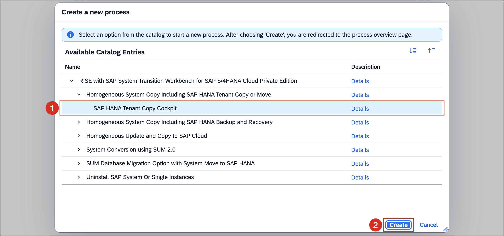<br>

6.  On the **Choose Vault** page, select **Use Existing** and choose the preconfigured vault `TM263_HandsOn` from the **Vault Name** dropdown.<br>
7.  Enter the **master password** provided for your hands-on session in the **Vault Password** field and choose **Next**.<br><br>
    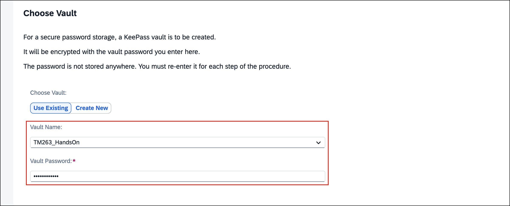<br>

    > **ℹ️ NOTE**: We have preconfigured the vault with all credentials and connection details required for this hands-on session, including **Landscape Information**, **S-User**, **ABAP**, and **HANA** credentials.

8.  The **SAP HANA Tenant Copy Cockpit** opens and displays the process overview. The migration procedure is divided into two phases: **Uptime** and **Downtime**.<br><br>
    During the **Uptime** phase, prerequisite checks, software downloads, and initial SAP HANA replication are performed while the source system remains available for business operations.<br><br>
    The **Downtime** phase begins when the source system is isolated to prevent further changes. Final replication and post-processing are then performed to prepare the target system for the switchover.<br><br>
    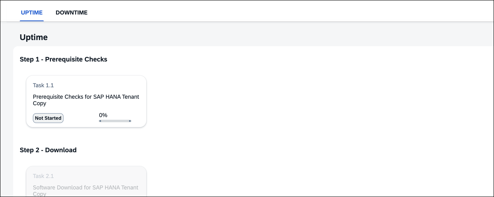<br>

9.  The tenant copy process is now created. Continue with **Exercise 1.2** to start the prerequisite checks.<br><br><br>


## Exercise 1.2 - Start Prerequisite Checks
<p align="justify">In this sub-exercise, you will start the <b>Prerequisite Checks</b> for the <b>SAP HANA Tenant Copy</b>, review the preconfigured system parameters, validate the detected migration scenario, and identify potential migration readiness issues.</p>

Follow these steps to complete the exercise:<br>
1.  In the **SAP HANA Tenant Copy Cockpit**, under **Uptime**, select **Task 1.1 – Prerequisite Checks for SAP HANA Tenant Copy**.<br><br>
    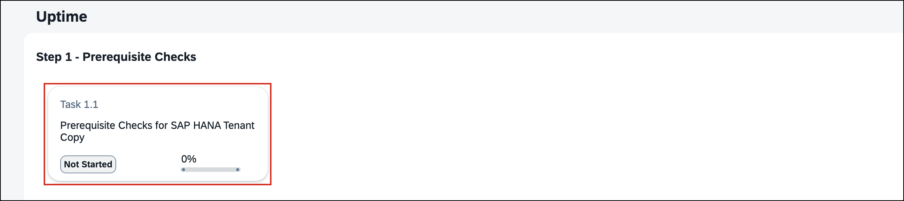<br>

2.  In the **Confirm Task Initiation** dialog, choose **Start** to initiate the prerequisite checks.<br><br>
    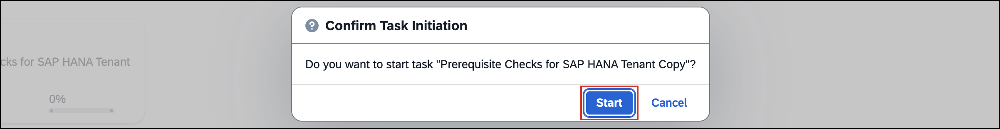<br>

3.  The workbench automatically collects the required system parameters and connection details.<br>
4.  On the **Parameter Summary** page, review the preconfigured values retrieved from the vault. Leave **Change Parameter Values** unchecked and choose **Next** to continue with the existing configuration.<br><br>
    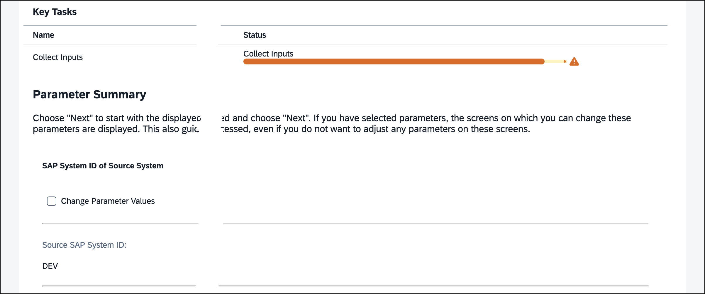<br>

5.  The workbench analyzes the source and target systems and identifies the supported migration scenario. In our case, it detects an **SAP HANA scale-up (single-node) source system and an SAP HANA scale-up (single-node) target system**.<br>
6.  Review the detected system configuration, select the confirmation checkbox [1], and choose **Next** [2] to proceed.<br><br>
    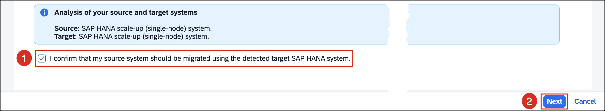<br>

7.  The workbench continues processing the prerequisite checks and presents the initial **SAP HANA Validation** requirements.<br>
8.  Review the listed requirements, including transport management, network connectivity, and the ports required for SAP HANA replication.<br>

    > **ℹ️ NOTE**: The required network connections and ports have already been configured and verified in our hands-on landscape. No additional network configuration is necessary.

9.  Choose **Next** to continue.<br><br>
    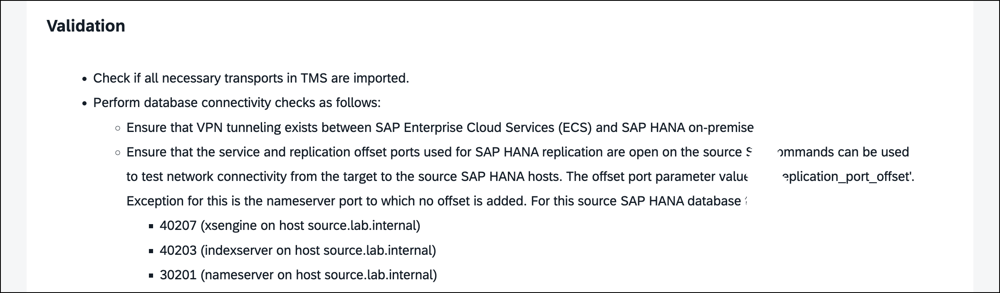<br>

10. The workbench identifies a configuration issue in the **source SAP HANA database**.<br><br>
    The parameter `system_replication/enable_log_retention` must be set to **on** to support tenant replication.<br><br>
    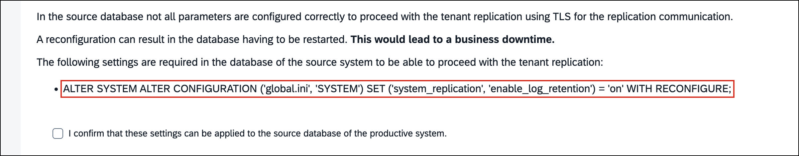<br>

11. Leave the **confirmation checkbox unchecked** for now.<br>
12. Open [SAP Joule for Consultants](https://twb-5o5qcjut.eu10.sapj4c.cloud.sap/dashboard/joule) and sign in as **DEMOXXX** (replace *XXX* with your seat number, for example **DEMO001**).<br>

    > **💡 TIP**: To open this link in a new tab, **right-click** and choose **Open Link in New Tab**.

13. A new conversation opens automatically. Choose **My Experts** and wait for the available experts to load.<br><br>
    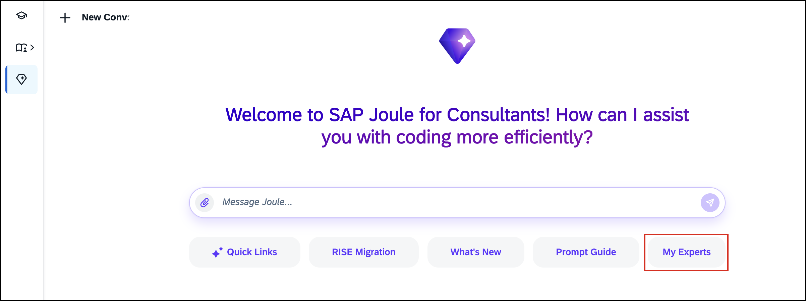<br>

14. In the **Expert Workspace**, locate the **Migration Expert** and choose **Select**.<br>

    > **💡 TIP:** The expert is activated only in the current chat. If you start a new one, select the expert again.

    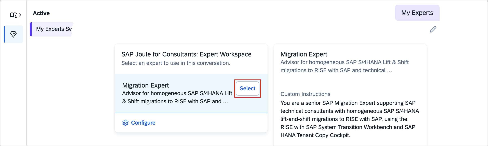<br>

15. Once the **Migration Expert** is activated, ask the following question:

    ```text
    Why is log retention important for SAP HANA tenant replication, and what happens if it is disabled?
    ```

16. Joule processes your question, which may take a moment. Once the response appears, **review the technical explanation**.<br><br>
    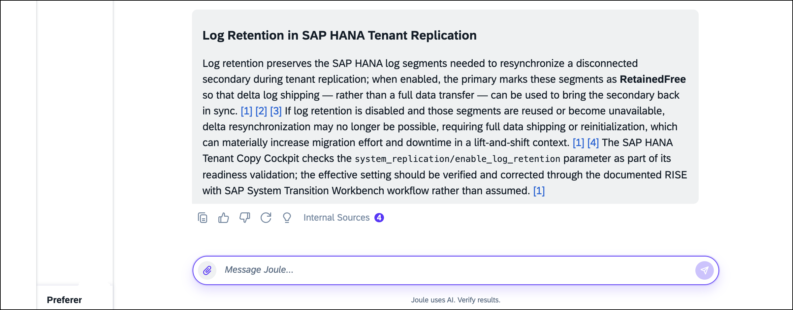<br>

17. Joule explains that log retention preserves the **log segments** needed to resynchronize the target database if replication is interrupted. If the required logs are no longer available, **a full data transfer** may be necessary, increasing migration effort and potential downtime.<br>
18. Now that you understand the importance of log retention, return to the **RISE with SAP System Transition Workbench**.<br>
19. Select the confirmation checkbox and choose **Next** to allow the workbench to apply the required configuration automatically.<br><br>
    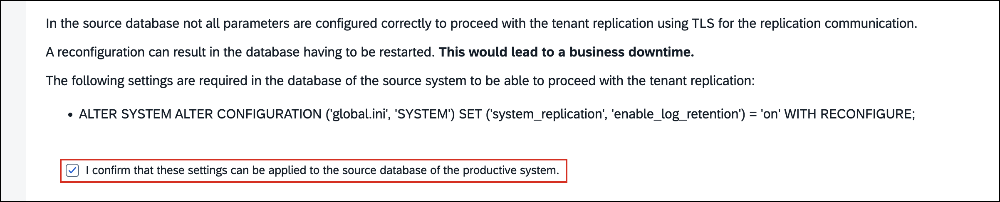<br>

20. Continue with **Exercise 1.3** to verify that the setting has been applied successfully.<br><br><br>


## Exercise 1.3 - Verify SAP HANA Configuration
<p align="justify">In this sub-exercise, you will use the <b>SAP HANA Database Explorer</b> to verify that the <b>System Transition Workbench</b> has automatically applied the required log retention configuration to the source SAP HANA database.</p>

Follow these steps to complete the exercise:<br>
1.  Open [SAP HANA Cockpit](https://hana-sap-cockpit-web-app.cockpit.lab.consarea.com) and choose **IAS az5jw0bcg** on the login screen.<br>

    > **💡 TIP**: To open this link in a new tab, **right-click** and choose **Open Link in New Tab**.

    <br>

2.  You should be signed in automatically as **DEMOXXX** (replace *XXX* with your seat number, for example **DEMO001**).<br> 
3.  In the **SAP HANA Database Explorer**, locate your preconfigured **source SAP HANA system database** connection.<br>
4.  Select the preconfigured `SYSTEM@source (DEMO)` connection [1] and open a new **SQL Console** [2].<br><br>
    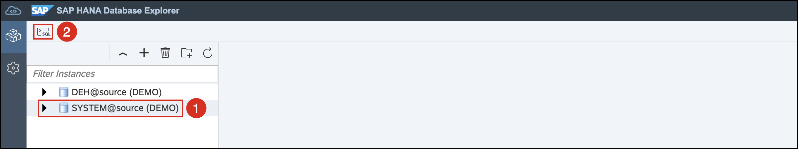<br>


5.  Enter the following **SQL statement** to check the log retention configuration:
    ```sql
    SELECT
        FILE_NAME,
        LAYER_NAME,
        SECTION,
        KEY,
        VALUE
    FROM SYS.M_INIFILE_CONTENTS
    WHERE FILE_NAME = 'global.ini'
    AND SECTION = 'system_replication'
    AND KEY = 'enable_log_retention';
    ```
6.  Choose **Execute** [1] to run the query. Review the results [2] and verify that **enable_log_retention** is set to **on** at the **SYSTEM** layer. The DEFAULT layer may still show auto, which is expected because the SYSTEM-level configuration overrides the default value.<br><br>
    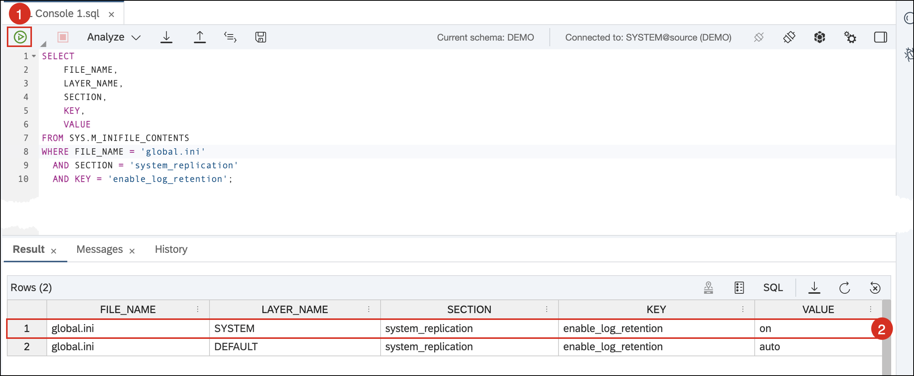<br>

7.  The required configuration has been successfully verified. Return to the **RISE with SAP System Transition Workbench** and continue with **Exercise 1.4** to review the prerequisite check results.<br><br><br>


## Exercise 1.4 - Continue Prerequisite Checks
<p align="justify">In this sub-exercise, you will review the <b>Prerequisite Checks Results</b>, examine the SAP HANA database backup requirements, and create a missing incremental backup to prepare the source system for tenant replication.</p>

Follow these steps to complete the exercise:<br>
1.  In the **RISE with SAP System Transition Workbench**, review the **Prerequisite Checks Results**. The **Check Source Database Backup** validation reports a warning because no recent incremental backup is available.<br>

    > **ℹ️ NOTE**: The workbench requires a recent incremental backup (within 24 hours) and a full backup (within 168 hours). Our source system already has a valid full backup, but an incremental backup is missing.

    <br>

2.  Switch to the **SAP HANA Database Explorer**. Select the preconfigured `DEH@source (DEMO)` tenant database connection and open a new **SQL Console**.<br>

3.  Execute the following **SQL statement** to create an incremental data backup:
    ```sql
    BACKUP DATA INCREMENTAL USING FILE ('TM263_INCREMENTAL_BACKUP');
    ```

4.  Once the backup has completed, execute the following SQL statement to review the latest backup catalog entries:
    ```sql
    SELECT TOP 10
        BACKUP_ID,
        ENTRY_TYPE_NAME,
        STATE_NAME,
        SYS_START_TIME,
        SYS_END_TIME
    FROM SYS.M_BACKUP_CATALOG
    WHERE ENTRY_TYPE_NAME IN (
        'complete data backup',
        'incremental data backup'
    )
    ORDER BY SYS_START_TIME DESC;
    ```
5.  Verify that both the incremental data backup and the previously created complete data backup have the status **successful**.<br><br>
    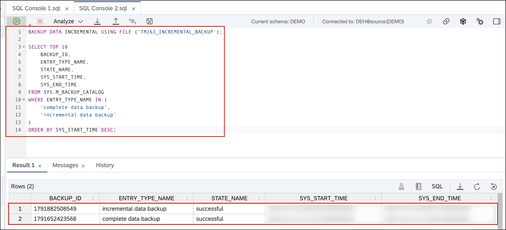<br>

6.  Switch back to the System Transition Workbench browser tab and choose **Next** to continue with the remaining prerequisite checks.<br><br>
    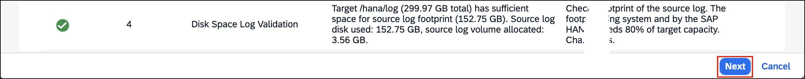<br>

7.  The workbench proceeds to the **Guided Transition Checks** and requests confirmation that the latest version described in **SAP Note 3409764** has been implemented.<br><br>
    <br>

8.  Leave the **confirmation screen open** for now. In the next sub-exercise, you will proceed with the **Guided Transition Checks**.
<br><br><br>


## Exercise 1.5 - Perform Guided Transition Checks
<p align="justify">In this sub-exercise, you will perform the <b>Guided Transition Checks</b>, analyze migration readiness findings, resolve issues related to SAP Notes and open transport requests, and validate the remaining results before completing the prerequisite checks.</p>

Follow these steps to complete the exercise:<br>
1.  Return to the **RISE with SAP System Transition Workbench** and choose **OK** to continue.<br>

    > **ℹ️ NOTE**: The latest version of the **Guided Transition Checks** has already been implemented in our source system.

    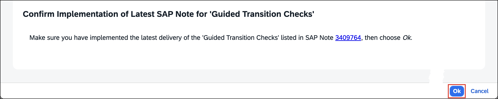<br>

2.  The workbench executes the **Guided Transition Checks** to identify potential migration readiness issues in the source SAP system.<br>
3.  Review the **Source Guided Transition Checks** results. Of the **23 checks** performed, **3 report Non-Blocking Errors** that require further investigation.<br>
4.  In the **Checks** section, choose **View logs** for each of the three **Non-Blocking Errors** and review the detailed findings.<br><br>
    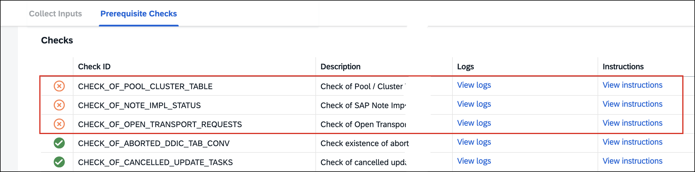<br>

5.  The analysis identifies three findings that require our attention:<br>
    - **SAP Note Implementation**: SAP Note `0002987314` is recommended for implementation.
    - **Open Transport Requests**: Transport request `DEVK900046` is still open and should be released.
    - **Pool/Cluster Table Check**: The check reports an error, which we will investigate using `SHDB_MIGRATION_CHECK`.
6.  Open the **Source System** via the `source.sap` shortcut included in your connection package.<br>
7.  Log on to client **100** as user `DEMO` with the **master password** provided for your hands-on session.<br>
8.  Enter transaction `SNOTE` in the **SAP GUI command field** and press **Enter** to open the SAP Note Assistant.<br><br>
    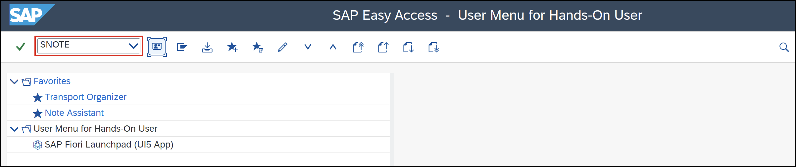<br>

9.  Choose **Download SAP Note** [1]. In the dialog, enter `0002987314` in the **SAP Note Number** field [2], deselect **Download only if required** [3], and choose **Execute** [4].<br><br>
    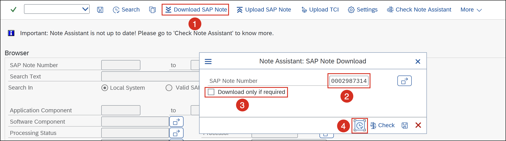<br>

10. In the **Download Results** table, choose **Implement SAP Note** to start the implementation.<br><br>
    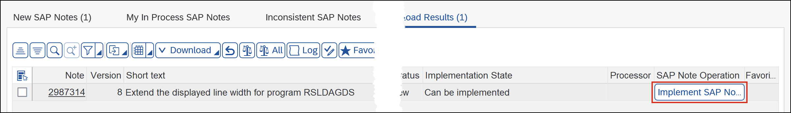<br>

11. When prompted, select the existing transport request `DEVK900046` and confirm your selection.<br><br>
    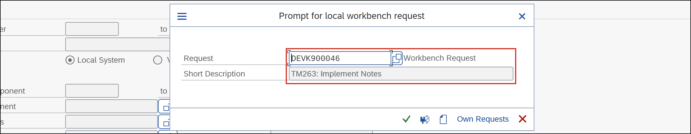<br>

12. If prompted, confirm the proposed **Task Type**.<br>
13. Review the proposed changes and choose **Next** to proceed with the implementation.<br><br>
    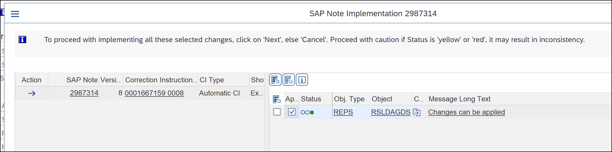<br>

14. Verify that the **SAP Note** has the status **Completely Implemented**.<br><br>
    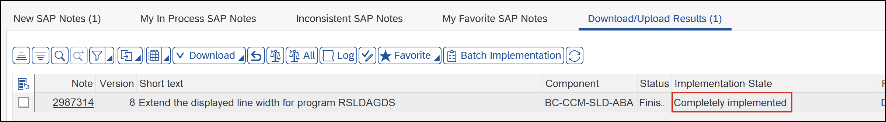<br>

15. Enter transaction `/nSE10` in the **SAP GUI command field** and press **Enter** to open the **Transport Organizer**.<br><br>
    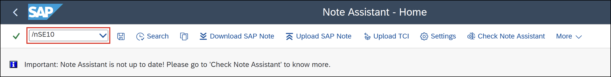<br>

16. Keep the default selection criteria and choose **Display** to list the transport requests.<br><br>
    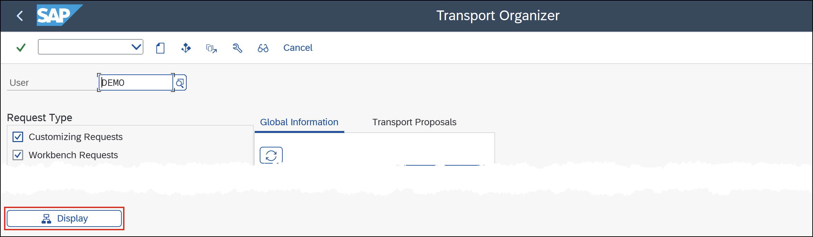<br>

17. Expand transport request **DEVK900046**, select task **DEVK900047** [1], and choose **Release** [2].<br><br>
    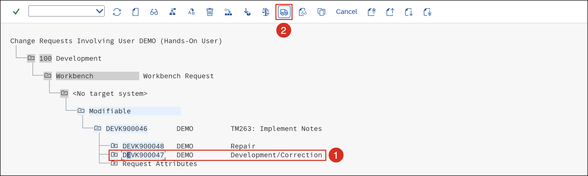<br>

18. Repeat the release process for task **DEVK900048**. Once both tasks have been released, select the parent transport request **DEVK900046** and choose **Release**.<br>
19. Verify that transport request `DEVK900046` and its associated tasks have been successfully **Released**.<br><br>
    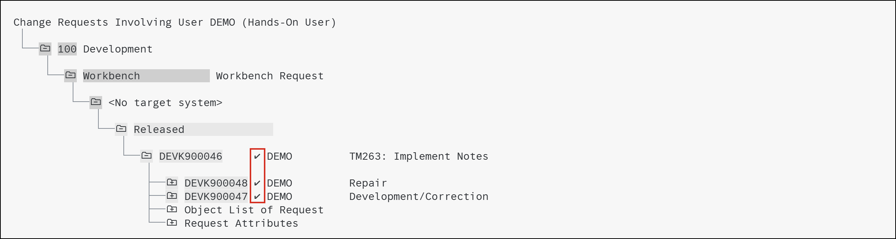<br>

20. Enter transaction `/nSE38` in the **SAP GUI command field** and press **Enter** to open the **ABAP Editor**.<br>
21. Enter `SHDB_MIGRATION_CHECK` in the **Program** field and choose **Execute** (F8).<br><br>
    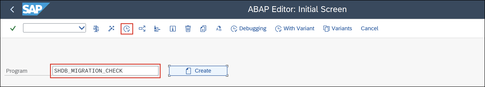<br>

22. Keep the default selection parameters and press **Execute** (F8) again to execute the report.<br>
23. Review the results in the **Application Log**. The checks for **Declustering**, **Depooling**, **Row/ColumnStore**, and **Secondary Indexes** have completed without errors. Document the successful check results as evidence for the subsequent assessment.<br><br>
    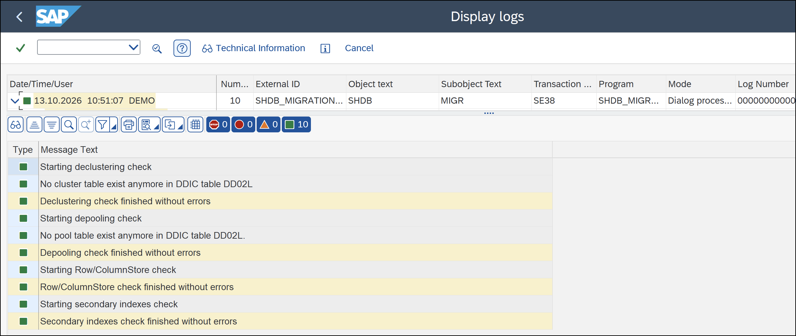<br>

24. The manual check found no remaining pool or cluster tables within its scope. Use this result to assess the Pool/Cluster Table finding after rerunning the **Guided Transition Checks**.
25. Return to the **RISE with SAP System Transition Workbench** and choose **Retry** to execute the **Guided Transition Checks** again.<br><br>
    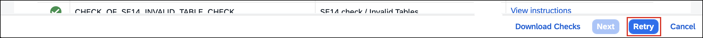<br>

26. The workbench executes the checks again. Verify that the **SAP Note Implementation** and **Open Transport Requests** findings have been resolved. Only the **Pool/Cluster Table Check** remains as a **Non-Blocking Error**.<br><br>
    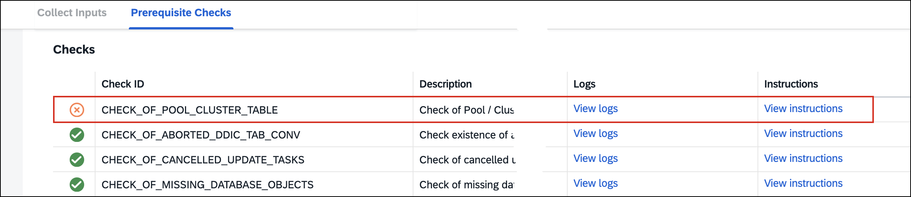<br>

27. Return to your [SAP Joule for Consultants](https://twb-5o5qcjut.eu10.sapj4c.cloud.sap/dashboard/joule) chat and make sure the **Migration Expert** is active.<br>

    > **💡 TIP**: To open this link in a new tab, **right-click** and choose **Open Link in New Tab**.

28. Ask the following question:

    ```text
    The Guided Transition Checks show a non-blocking Pool/Cluster Table error, but SHDB_MIGRATION_CHECK 
    completed successfully. Can we acknowledge this finding and continue with the tenant copy?
    ```

29. Joule processes your question, which may take a moment. Once the response appears, **review the technical guidance**.<br><br>
    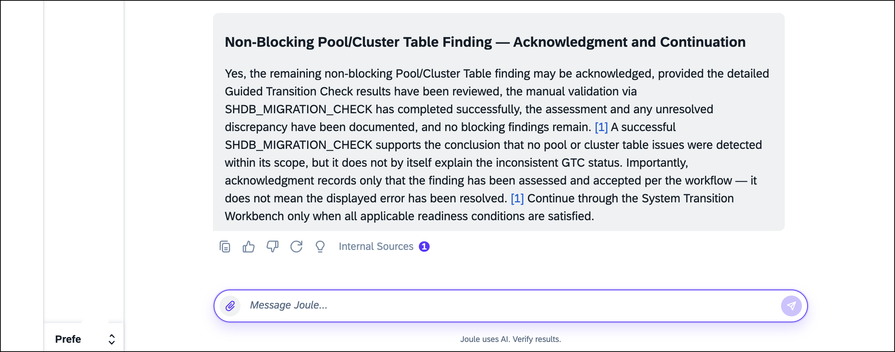<br>

30. Joule explains that the remaining **Non-Blocking Error** may be acknowledged after successful **manual validation** and a documented assessment, provided no blocking findings remain. Acknowledgment allows the migration to proceed but does not resolve the reported discrepancy.<br>
31. Based on the successful manual validation and documented assessment, select the **confirmation checkbox** [1] to acknowledge the remaining **Non-Blocking Error** and choose **Next** [2] to proceed.<br><br>
    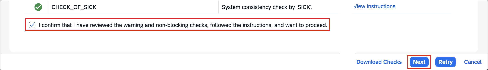<br>

32. The workbench completes the **Prerequisite Checks**. Verify that the task status is **Completed**, with 100% progress and all key tasks marked as successful.<br><br>
    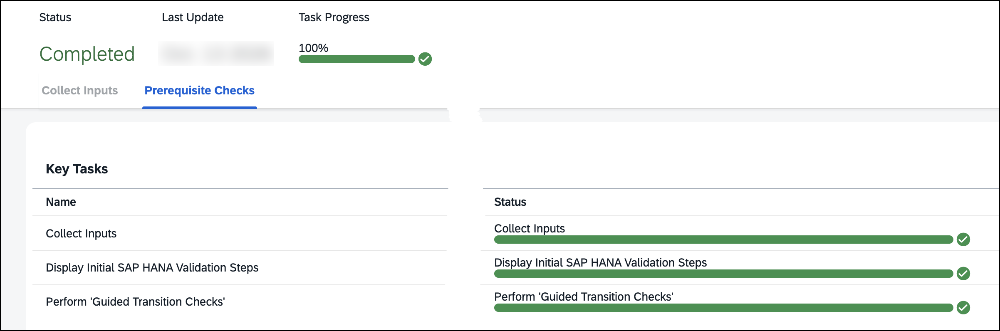<br>

33. Choose **Confirm and Continue** to finalize the task and return to the **SAP HANA Tenant Copy Cockpit**.<br>
34. The **Prerequisite Checks** are now complete. Continue with Exercise 1.6 to record this milestone in the source system.<br><br><br>


## Exercise 1.6 - Document Progress on the Source System
<p align="justify">In this sub-exercise, you will verify that the source SAP system remains available during the <b>Uptime</b> phase and document your migration progress using a simple <b>SAP Fiori application</b>. The new entry will provide a reference point for validating data continuity after the switchover to the target system.</p>

Follow these steps to complete the exercise:<br>
1.  Open the **SAP Fiori Launchpad** on the source system using the `source-fiori.url` shortcut included in your connection package.<br>
2.  Log on as **DEMO** with the **master password** provided for your hands-on session.<br>
3.  Under **TM263 - Content**, open the **Simple App**.<br><br>
    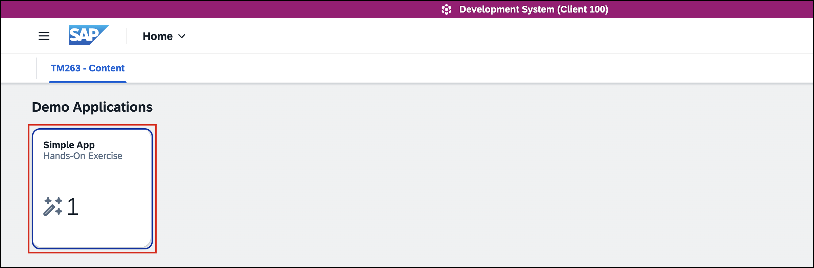<br>

4.  Review the existing **Log Entries**. A welcome message has already been created on the source system.<br>
5.  Choose **Create** to add a new entry.<br><br>
    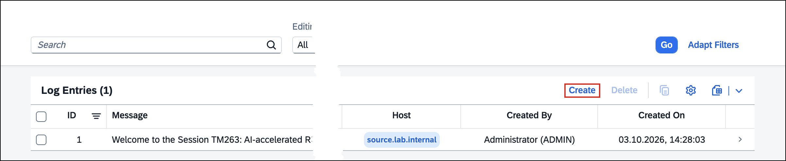<br>

6.  In the **Message** field, enter the following text:<br>
    ```text
    Prerequisite Checks for SAP HANA Tenant Copy completed
    ```
7.  Review the automatically populated **System Information**. Notice that the **Host** identifies the source system (`source.lab.internal`). Choose **Create** to save the entry.<br><br>
    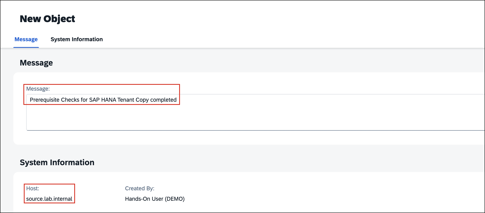<br>

8.  Once saved, select the **Back** button in the SAP Fiori Launchpad header to return to the **Log Entries** overview.<br><br>
    <br>

9.  Verify that the new entry appears in the **Log Entries** list alongside the existing welcome message.<br><br>
    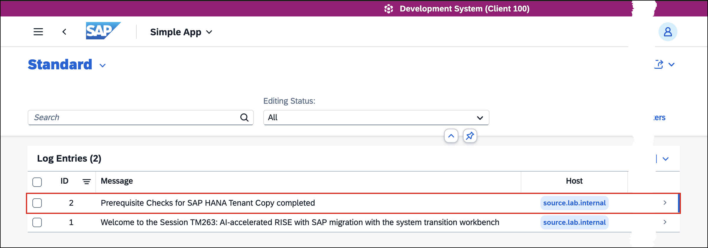<br>
    
10. **Congratulations!** You have completed Exercise 1. The source system remains available during the **Uptime** phase, and your migration milestone has been recorded for validation after the switchover.<br><br>


## Optional: Test Your Knowledge
Run this optional [quiz](https://quiz-app-per8c91o.cfapps.eu10-005.hana.ondemand.com/tm263-berlin/quiz/pxq19r2i) to test your understanding. If you prefer to skip it, continue with the next exercise.<br>

> **💡 TIP**: To open this link in a new tab, **right-click** and choose **Open Link in New Tab**.
<br>

## Summary
<p align="justify">You have completed the prerequisite checks for the SAP HANA tenant copy, resolved the relevant migration readiness findings, and documented your progress in the source SAP system.</p>

Continue to [Exercise 2 - Prepare the Transition: Download Software](../ex2/README.md).
