# Exercise 2 - Prepare the Transition: Download Software
<p align="justify">In this exercise, you will review the software preparation completed in <b>SAP Maintenance Planner</b>, use the <b>RISE with SAP system transition workbench</b> to download the required software archives, and record your progress while the source SAP system remains available during the <b>Uptime</b> phase.</p><br>

This exercise consists of the following sub-exercises:
- [Exercise 2.1 – Review Maintenance Planner Preparation](#exercise-21--review-maintenance-planner-preparation)
- [Exercise 2.2 – Download Required Software](#exercise-22--download-required-software)
- [Exercise 2.3 – Document Progress on the Source System](#exercise-23--document-progress-on-the-source-system)

<br>

## Exercise 2.1 – Review Maintenance Planner Preparation
<p align="justify">In this sub-exercise, you will review the <b>SAP Maintenance Planner</b> preparation completed in advance, including the planned transition to RISE and the required software selection.</p>

Review the following preparation completed for this hands-on session:<br>
1.  In **SAP Maintenance Planner**, we prepared a plan for our source system **DEV** and selected **Plan a Transition to RISE**.<br><br>
    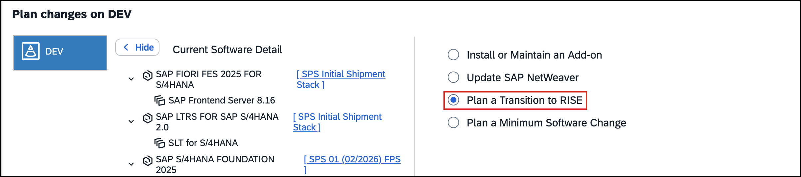<br>

2.  Based on this plan, we identified the required **software components** and prepared the corresponding **Download Files** selection.<br><br>
    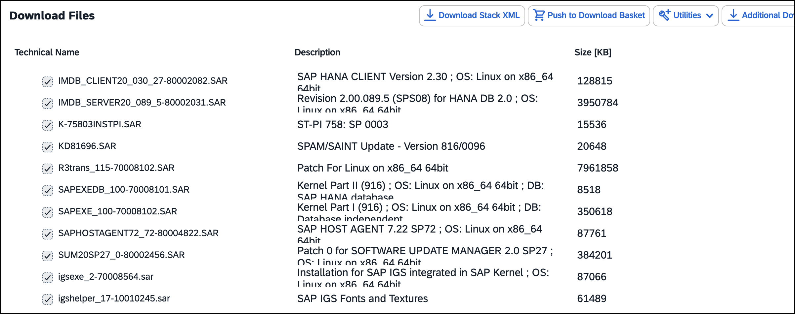<br>

3.  The resulting **Maintenance Planner Transaction ID** was extracted and stored in the preconfigured vault.<br><br><br>


## Exercise 2.2 – Download Required Software
<p align="justify">In this sub-exercise, you will use the <b>RISE with SAP system transition workbench</b> to retrieve the prepared <b>Maintenance Planner</b> transaction and download the software archives required for the <b>SAP HANA Tenant Copy</b>.</p>

Follow these steps to complete the exercise:<br>
1.  In the **SAP HANA Tenant Copy Cockpit**, under **Uptime**, select **Task 2.1 – Software Download for SAP HANA Tenant Copy**.<br><br>
    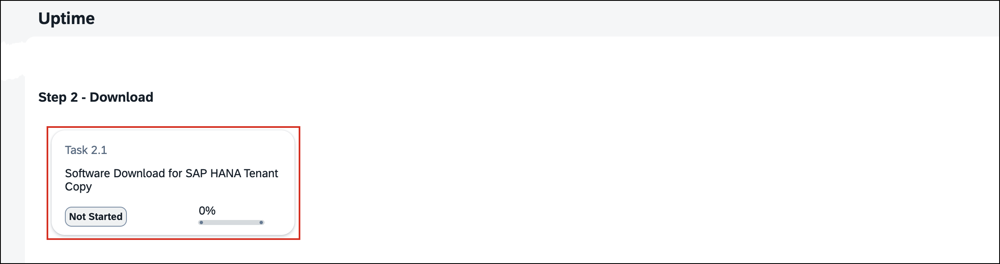<br>

2.  In the **Confirm Task Initiation** dialog, choose **Start**.<br>
3.  The workbench starts collecting the inputs required for the software download.<br>

4.  On the **Download Directory Path** page, enter `/install/downloads` in the **Download Directory** field and choose **Next** to continue.<br><br>
    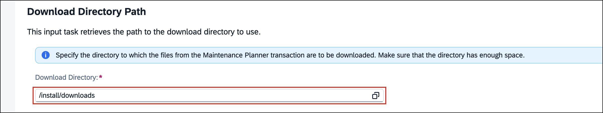<br>

5.  On the **Parameter Summary** page, review the preconfigured values retrieved from the vault, including the **S-User Name** and **Maintenance Planner Transaction ID**. Leave **Change Parameter Values** unchecked and choose **Next** to continue with the existing configuration.<br><br>
    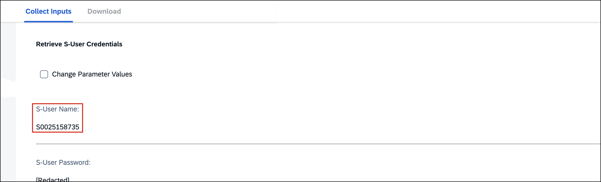<br>

6.  The workbench starts the **Download Software Archives for Maintenance Planner Transaction** task.<br><br>
    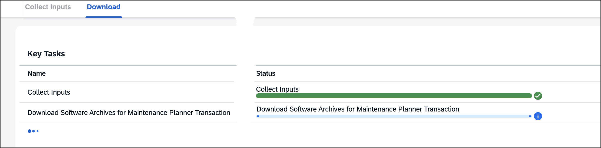<br>

7.  During the **Check for Existing Validity XML File** step, the workbench detects that no valid previous download information is available in the specified directory. Choose **Next** to perform a full software download.<br><br>
    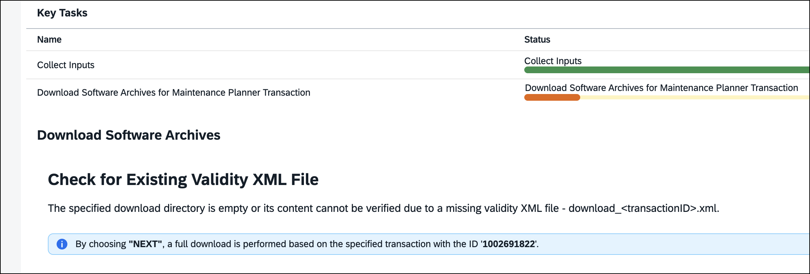<br>

8.  The workbench downloads the required software archives to `/install/downloads`. Wait until the download process has completed.<br><br>
    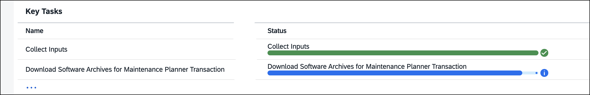<br>

9.  On the **Download SAP HANA Studio** page, review the installation instructions and choose **Next** to continue.<br>

    > **ℹ️ NOTE**: **SAP HANA Studio** is not required for this hands-on session. No additional installation is necessary.

10. Verify that the software download task has the status **Completed**, with **100% progress** and all key tasks marked as successful.<br><br>
    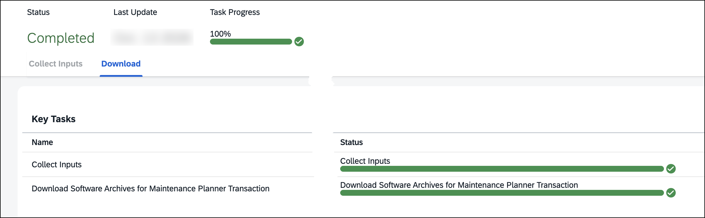<br>

11. Choose **Confirm and Continue** to return to the **SAP HANA Tenant Copy Cockpit**. Continue with **Exercise 2.3** to document this milestone on the source system.<br><br><br>


## Exercise 2.3 – Document Progress on the Source System
<p align="justify">In this sub-exercise, you will document the successful software download in the <b>Simple App</b> and verify that the source SAP system remains available during the <b>Uptime</b> phase.</p>

Follow these steps to complete the exercise:<br>
1.  Return to the **SAP Fiori Launchpad** on the source system and open the **Simple App**.<br>
2.  Review the existing **Log Entries** and choose **Create** to add a new entry.<br>
3.  In the **Message** field, enter the following text:<br>
    ```text
    Software Download for SAP HANA Tenant Copy completed
    ```
    Verify that the **Host** identifies the source system (`source.lab.internal`) and choose **Create** to save the entry.<br><br>
    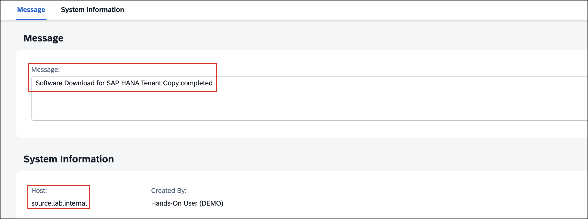<br>

4.  Verify that the new entry appears in the **Log Entries** list alongside the previously recorded messages.<br><br>
    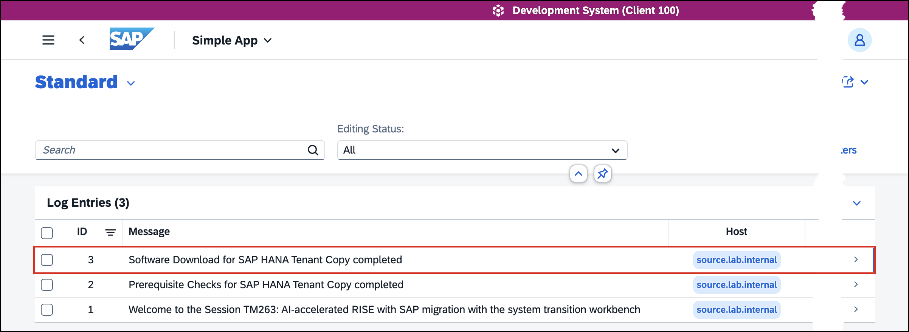<br>

5.  **Congratulations!** You have completed Exercise 2. The required software has been downloaded, and your migration progress has been recorded while the source system remains available.<br><br><br>

## Optional: Test Your Knowledge
Run this optional [quiz](https://quiz-app-per8c91o.cfapps.eu10-005.hana.ondemand.com/tm263-berlin/quiz/ciaho0fo) to test your understanding. If you prefer to skip it, continue with the next exercise.<br>

> **💡 TIP**: To open this link in a new tab, **right-click** and choose **Open Link in New Tab**.
<br>

## Summary
<p align="justify">You have reviewed the prepared <b>SAP Maintenance Planner</b> transition plan, downloaded the software archives required for the <b>SAP HANA tenant copy</b> with the <b>System Transition Workbench</b>, and documented your progress in the source system. The source SAP system remains available during the <b>Uptime</b> phase.</p>

<p align="justify">With the required software available, you are ready to prepare the SAP HANA systems and establish replication in the next exercise.</p>

Continue to [Exercise 3 - Establish Replication: Prepare & Replicate SAP HANA](../ex3/README.md)