# Exercise 3 - Establish Replication: Prepare & Replicate SAP HANA
<p align="justify">In this exercise, you will prepare the <b>Intermediate System</b> on the Migration Server, initialize and monitor <b>SAP HANA tenant replication</b> between the source and target systems, and verify that the source system remains available during the <b>Uptime</b> phase. You will document both milestones in the <b>Simple App</b> for validation after the switchover.</p><br>

This exercise consists of the following sub-exercises:
- [Exercise 3.1 – Prepare the Intermediate System](#exercise-31--prepare-the-intermediate-system)
- [Exercise 3.2 – Document Progress on the Source System (Part 1)](#exercise-32--document-progress-on-the-source-system-part-1)
- [Exercise 3.3 – Initialize and Monitor SAP HANA Replication](#exercise-33--initialize-and-monitor-sap-hana-replication)
- [Exercise 3.4 – Document Progress on the Source System (Part 2)](#exercise-34--document-progress-on-the-source-system-part-2)


<br>

## Exercise 3.1 – Prepare the Intermediate System
<p align="justify">In this sub-exercise, you will configure the required parameters and use the <b>RISE with SAP System Transition Workbench</b> to install the <b>Intermediate System</b> on the <b>Migration Server</b>, preparing the environment for the SAP HANA tenant copy.</p>

Follow these steps to complete the exercise:<br>
1.  In the **SAP HANA Tenant Copy Cockpit**, under **Uptime**, select **Task 3.1 – Preparation for SAP HANA Tenant Copy**.<br><br>
    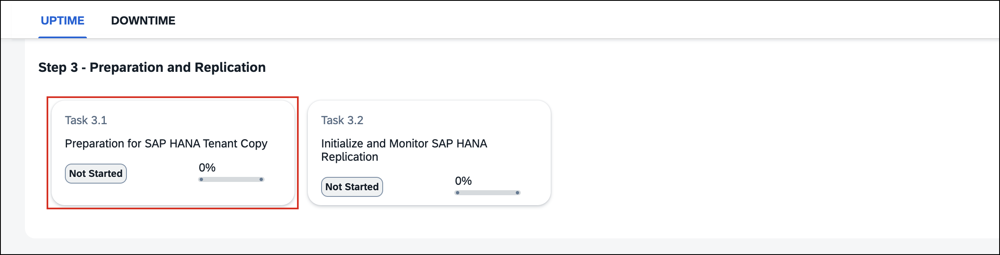<br>

2.  In the **Confirm Task Initiation** dialog, choose **Start**.<br>
3.  The workbench starts the **Collect Inputs** phase and requests the configuration parameters required to prepare the **Intermediate System**.<br>
4.  On the **Query SAP System Administrator Password on Migration VM** page, enter the **master password** provided for your hands-on session in both password fields and choose **Next**.<br><br>
    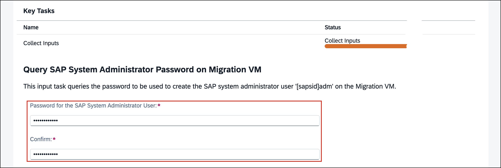<br>

5.  In the **Intermediate System – ASCS Instance Number** field, enter `04` and choose **Next**.<br><br>
    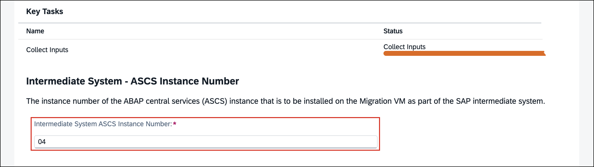<br>

6.  In the **Intermediate System – PAS Instance Number** field, enter `03` and choose **Next**.<br><br>
    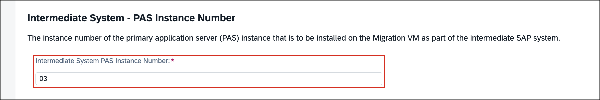<br>

7.  On the **Parameter Summary** page, review the preconfigured system parameters. Leave **Change Parameter Values** unchecked and choose **Next** to continue with the existing configuration.<br><br>
    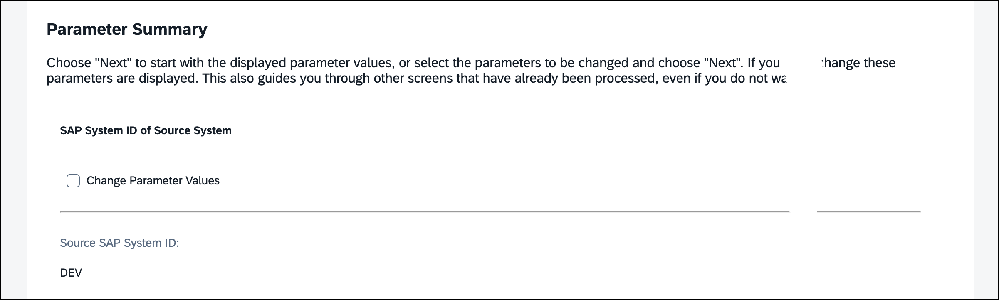<br>

8.  The workbench installs the **Intermediate System** on the **Migration VM**, including the **Skeleton System**, **ABAP Central Services (ASCS)**, and the **Primary Application Server (PAS)** instance stub. Wait until the installation is complete.<br><br>
    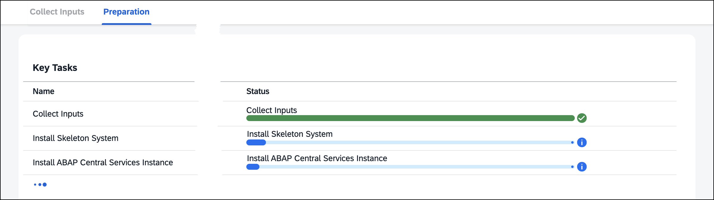<br>

9.  Verify that **Task 3.1 – Preparation for SAP HANA Tenant Copy** has the status **Completed**, with **100% progress** and all key tasks marked as successful.<br><br>
    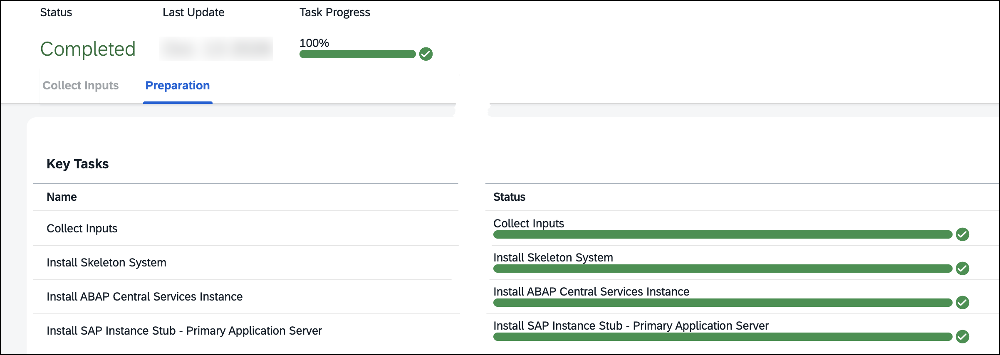<br>

10. Choose **Confirm and Continue** to return to the **SAP HANA Tenant Copy Cockpit**. Continue with **Exercise 3.2** to document this milestone on the source system.<br><br><br>


## Exercise 3.2 – Document Progress on the Source System (Part 1)
<p align="justify">In this sub-exercise, you will document the completed <b>Intermediate System</b> preparation in the <b>Simple App</b> and verify that the source SAP system remains available during the <b>Uptime</b> phase.</p>

Follow these steps to complete the exercise:<br>
1.  Return to the **SAP Fiori Launchpad** on the source system and open the **Simple App**.<br>
2.  Review the existing **Log Entries** and choose **Create** to add a new entry.<br>
3.  In the **Message** field, enter the following text:<br>
    ```text
    Preparation for SAP HANA Tenant Copy completed
    ```
    Verify that the **Host** identifies the source system (`source.lab.internal`) and choose **Create** to save the entry.<br><br>
    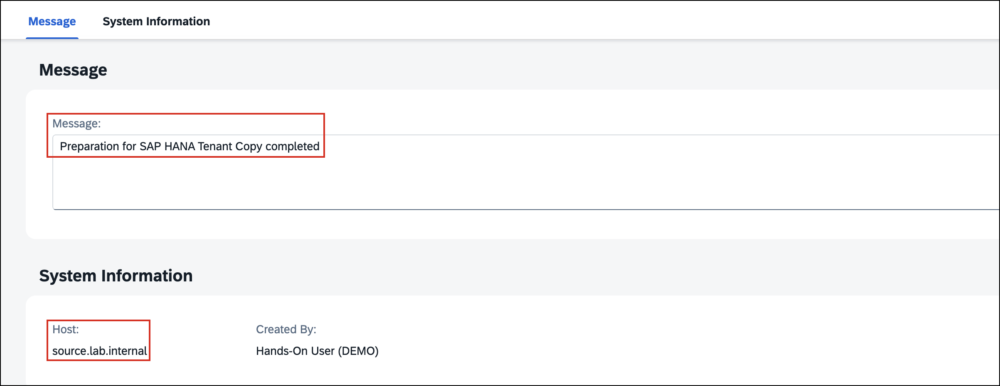<br>

4.  Verify that the new entry appears in the **Log Entries** list alongside the previously recorded messages.<br><br>
    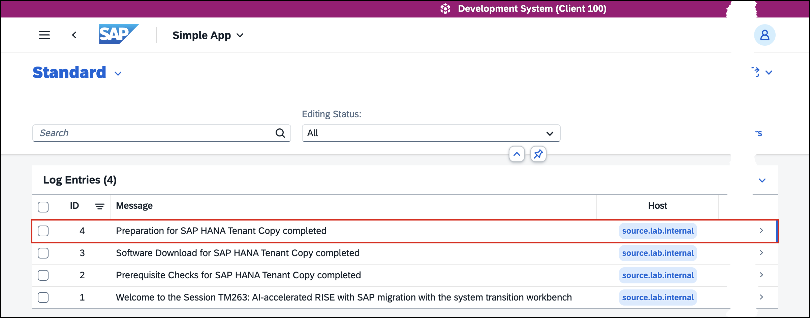<br>

5.  The **Intermediate System preparation** milestone is now recorded while the source system remains available. Continue with **Exercise 3.3** to initialize and monitor SAP HANA replication.<br><br><br>


## Exercise 3.3 – Initialize and Monitor SAP HANA Replication
<p align="justify">In this sub-exercise, you will use the <b>RISE with SAP System Transition Workbench</b> to initialize and monitor <b>SAP HANA tenant replication</b> between the source and target systems while the source system remains available during the <b>Uptime</b> phase.</p>

Follow these steps to complete the exercise:<br>
1.  In the **SAP HANA Tenant Copy Cockpit**, under **Uptime**, select **Task 3.2 – Initialize and Monitor SAP HANA Replication**.<br><br>
    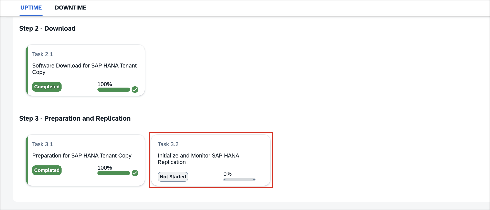<br>
2.  In the **Confirm Task Initiation** dialog, choose **Start**.<br>
3.  The workbench starts the **Collect Inputs** phase and retrieves the required system parameters and connection details.<br>
4.  On the **Parameter Summary** page, review the preconfigured values, including the **Target Database Host**. Leave **Change Parameter Values** unchecked and choose **Next** to continue with the existing configuration.<br><br>
    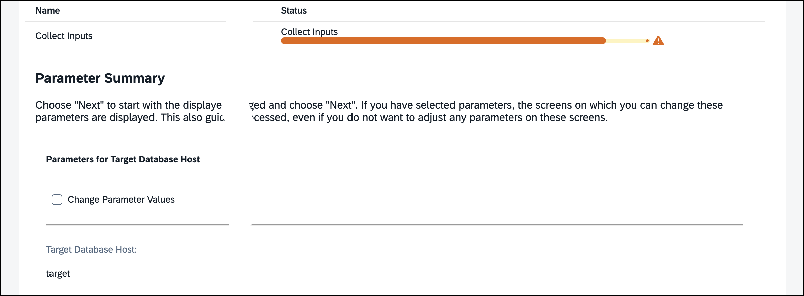<br>

5.  During the **Prepare SAP HANA Source Database for Replication** step, the workbench requests confirmation that an up-to-date backup of the source database tenant exists. Select the **confirmation checkbox** and choose **Next** to continue.<br><br>
    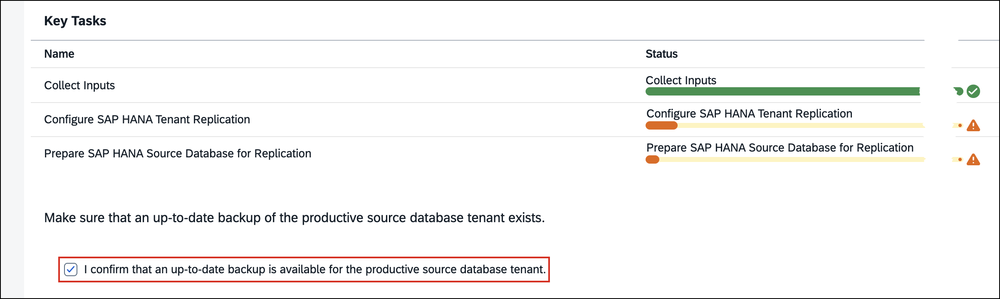<br>

6.  The workbench may display an additional **backup warning** indicating that incremental backups are missing.<br><br>
    Review the backup information and confirm that the backup state is acceptable for this workshop. Then select **I confirm that I am aware of the backup warning and I want to continue** and choose **Next** to proceed.<br><br>
    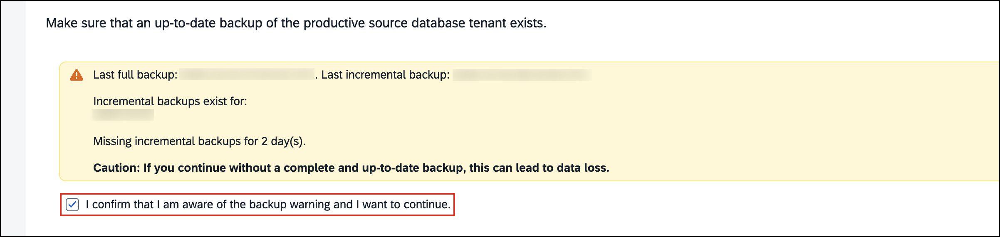<br>

7.  The workbench automatically configures **SAP HANA tenant replication**, prepares the source and target databases, and starts the replication process.<br><br>
    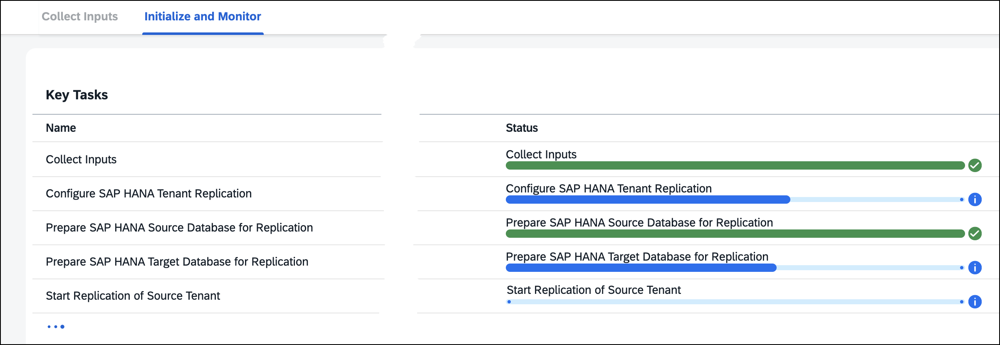<br>

    > **ℹ️ NOTE:** Initializing SAP HANA replication may take up to **10 minutes**. Wait until the replication status is **ACTIVE** before proceeding.

8.  Under **Monitor Replication Status**, verify that the replication status changes to **ACTIVE**. Once the status is **ACTIVE**, choose **Next** to proceed.<br><br>
    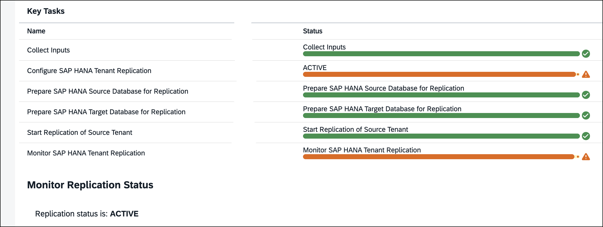<br>

9.  Verify that **Initialize and Monitor SAP HANA Replication** has the status **Completed**, with **100% progress** and all key tasks marked as successful.<br><br>
    <br>

10. Switch back to the [Joule for Consultants](https://twb-5o5qcjut.eu10.sapj4c.cloud.sap/dashboard/joule) browser tab and make sure the **Migration Expert** is active.<br>

    > **💡 TIP**: To open this link in a new tab, **right-click** and choose **Open Link in New Tab**.

11. Ask the following question:<br>
    ```text
    SAP HANA tenant replication is now ACTIVE. What does this mean, and what needs to happen before
    we can switch to the target system?
    ```
12. Joule processes your question, which may take a moment. Once the response appears, **review the technical explanation**.<br><br>
    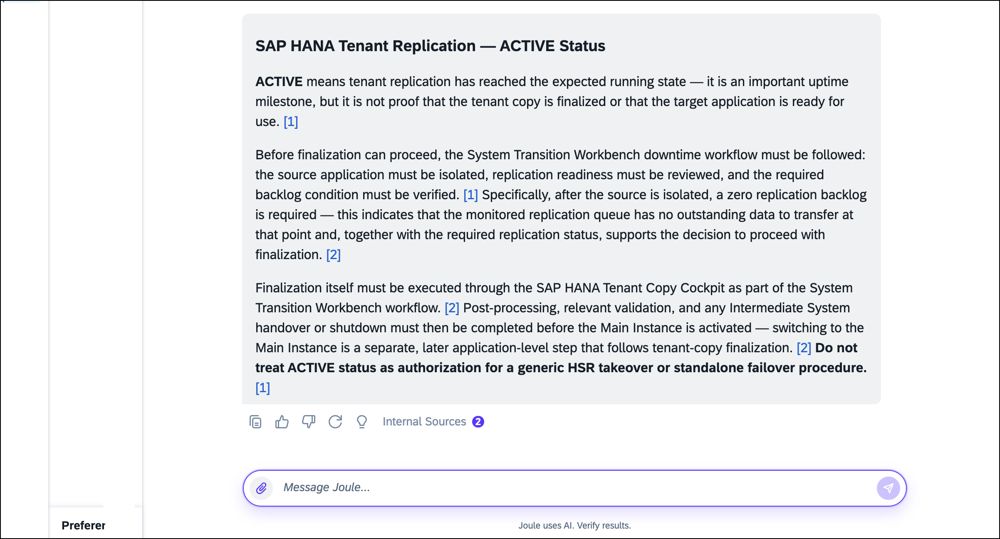<br>

13. Joule explains that **ACTIVE** confirms the expected replication status during **Uptime**, but does not mean the tenant copy is finalized.<br><br>
    The **RISE with SAP System Transition Workbench** guides the subsequent **Downtime** activities, including source application isolation, replication backlog verification, and finalization through the **SAP HANA Tenant Copy Cockpit**. **Post-Processing** and the subsequent switch to the **Main Instance** are handled as separate steps.<br>
14. Switch back to the **RISE with SAP System Transition Workbench** browser tab. Choose **Confirm and Continue** to return to the **SAP HANA Tenant Copy Cockpit**. Then proceed with **Exercise 3.4** to document this milestone on the source system.<br><br><br>


## Exercise 3.4 – Document Progress on the Source System (Part 2)
<p align="justify">In this sub-exercise, you will document the successful initialization of <b>SAP HANA tenant replication</b> in the <b>Simple App</b> and verify that the source SAP system remains available during the <b>Uptime</b> phase.</p>

Follow these steps to complete the exercise:<br>
1.  Return to the **SAP Fiori Launchpad** on the source system and open the **Simple App**.<br>
2.  Review the existing **Log Entries** and choose **Create** to add a new entry.<br>
3.  In the **Message** field, enter the following text:<br>
    ```text
    Initialize and Monitor SAP HANA Replication completed
    ```
    Verify that the **Host** identifies the source system (`source.lab.internal`) and choose **Create** to save the entry.<br><br>
    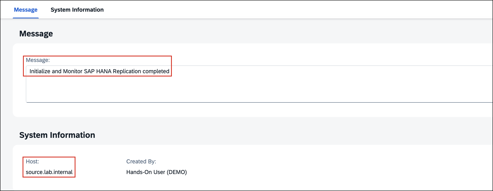<br>

4.  Verify that the new entry appears in the **Log Entries** list alongside the previously recorded messages.<br><br>
    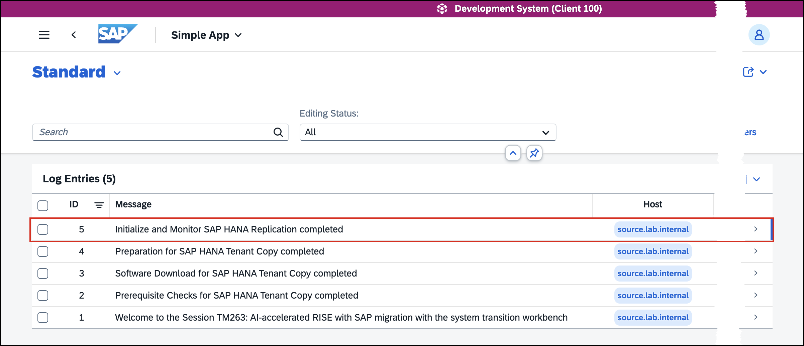<br>

5.  **Congratulations!** You have completed Exercise 3. The **Intermediate System** has been installed, **SAP HANA tenant replication** is **ACTIVE**, and both milestones have been recorded while the source system remains available.<br><br><br>


## Optional: Test Your Knowledge
Run this optional [quiz](https://quiz-app-per8c91o.cfapps.eu10-005.hana.ondemand.com/tm263-berlin/quiz/l7iirfd9) to test your understanding. If you prefer to skip it, continue with the next exercise.<br>

> **💡 TIP**: To open this link in a new tab, **right-click** and choose **Open Link in New Tab**.
<br>

## Summary
<p align="justify">You have installed the <b>Intermediate System</b> on the Migration Server and initialized <b>SAP HANA tenant replication</b> between the source and target systems. The replication status is <b>ACTIVE</b>, and the source SAP system remains available during the <b>Uptime</b> phase. Both preparation and replication milestones have been recorded in the <b>Simple App</b> and can be revisited after the switchover.</p>

In the next exercise, you will enter the **Downtime** phase and finalize the SAP HANA tenant copy.

Continue to [Exercise 4 - Finalize the Tenant Copy](../ex4/README.md)