# Exercise 4 - Finalize the Tenant Copy

In this exercise, you will enter the <b>Downtime</b> phase, isolate the source SAP system, and use the <b>RISE with SAP System Transition Workbench</b> to finalize the <b>SAP HANA tenant copy</b>. You will monitor the final replication, review table record count comparisons, and start the application on the Migration Server.
 

## Steps:
Follow these steps to complete the exercise: 
1.  In the **SAP HANA Tenant Copy Cockpit**, under **Downtime**, select **Task 1.1 – Finalize Tenant Replication for SAP HANA Tenant Copy**.  
    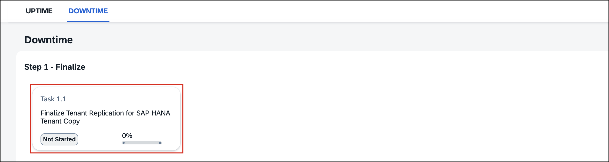 

2.  In the **Confirm Task Initiation** dialog, choose **Start**. 
3.  The workbench starts the **Collect Inputs** phase and retrieves the required system parameters and connection details. 
4.  On the **Parameter Summary** page, review the preconfigured values. Leave **Change Parameter Values** unchecked and choose **Next** to continue with the existing configuration.  
    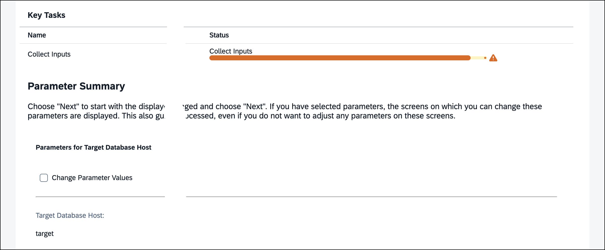 

5.  On the **Monitor Replication Status** screen, choose **Next** to proceed. 
6.  The workbench starts the **Finalize Replication** phase and displays the required preparation steps.  
    Review the source-isolation checklist, including user logoff, outstanding requests, and background-job considerations. Follow the next steps to isolate the source application server.  

    > **⚠️ CAUTION**: Do **NOT** choose **Next** in the **System Transition Workbench** until instructed to do so and the **Source Application Server** has been successfully isolated.

     

    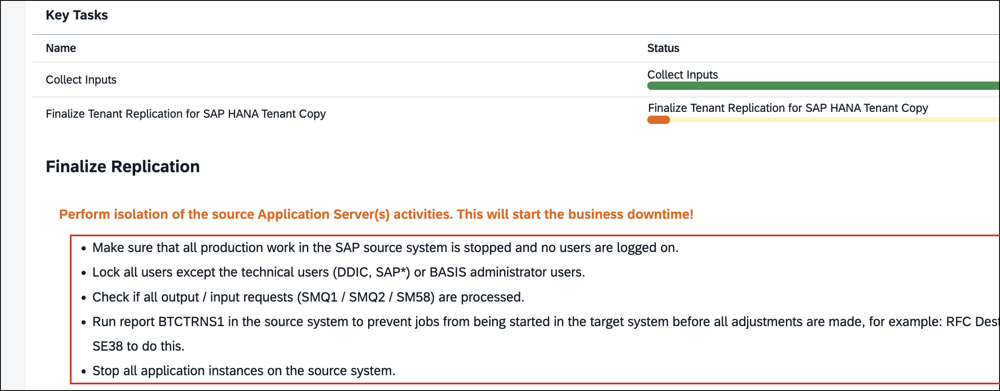 

7.  Open the [Lab Control](https://control.lab.consarea.com/source-isolation/) and log on as **DEMOXXX** (replace *XXX* with your seat number, for example **DEMO001**). 
8.  Under **Isolate the Source Application Server**, choose **Stop Application Server**.  

    > **⚠️ CAUTION**: Before stopping the **Source Application Server**, verify that the displayed hostname matches your assigned **seat number** (for example, **source-001.lab.internal** for seat **001**). **Do not proceed if the hostname does not match!** You could accidentally stop another participant's system. Contact your instructor if you are unsure.

     

    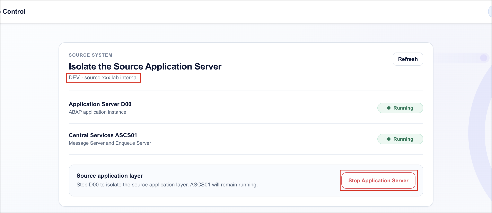 

9.  The source application server begins shutting down. Wait while the status changes from **Running** to **Stopping**.  
    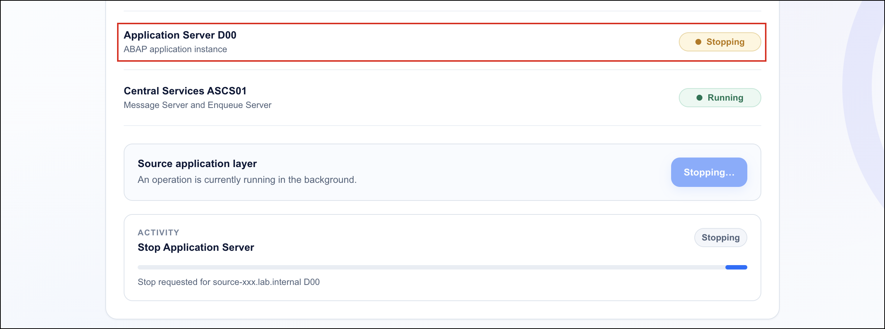 

10. Verify that the **Application Server D00** has the status **Stopped**, while **Central Services (ASCS01)** remains **Running**. Then switch back to the **System Transition Workbench** browser tab and choose **Next** to continue. 

    > **ℹ️ NOTE**: Isolating the source application server marks the beginning of the **Business Downtime**. From this point onward, users can no longer perform business operations on the source system.

    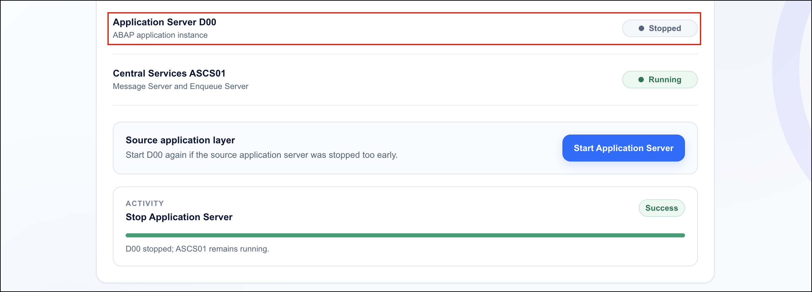 

11. The workbench prepares to execute **Table Record Checks** to compare record counts between the source and target systems. Leave **Skip table record checks** unchecked and choose **Next** to proceed.  
    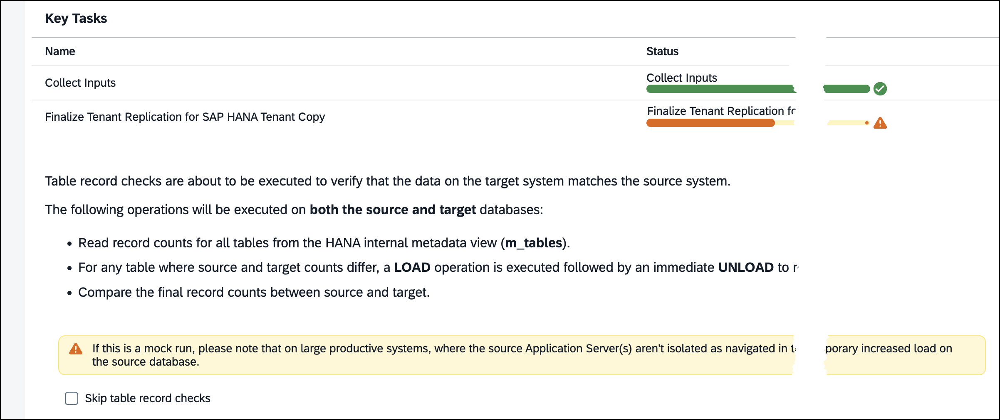 

12. Under **Monitor Replication Status**, review the replication information. Verify that the replication status is **ACTIVE** and that the **Backlog Size** has reached `0`, indicating that the outstanding replication data has been transferred.  
    Once verified, choose **Next** to proceed with the finalization process.  
    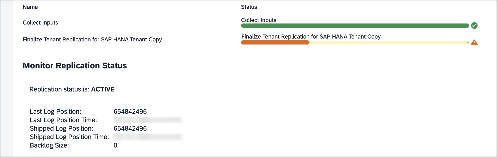 

13. The workbench continues with **SAP HANA tenant replication finalization**, performs the **table record checks**, and starts the application on the **Migration Server**.  
    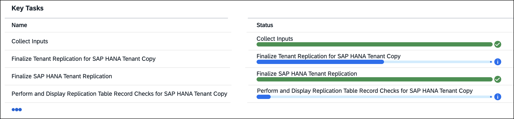 

14. Review the **Checking Table Records After SAP HANA Replication** results. Verify that the displayed record-count comparisons between the source and target systems have completed successfully. Then choose **Next** to proceed.  
    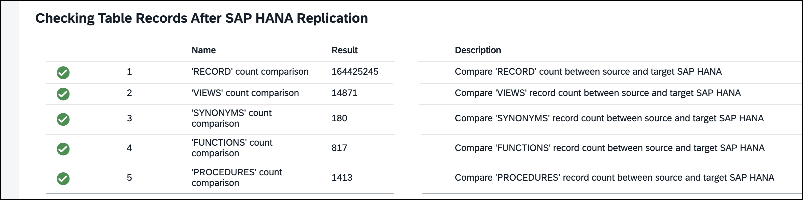 

15. Wait for the workbench to complete the finalization process, which may take a few minutes. Verify that the overall status is **Completed**, the progress reaches **100%**, and all **Key Tasks** are marked as successful (green checkmarks).  
    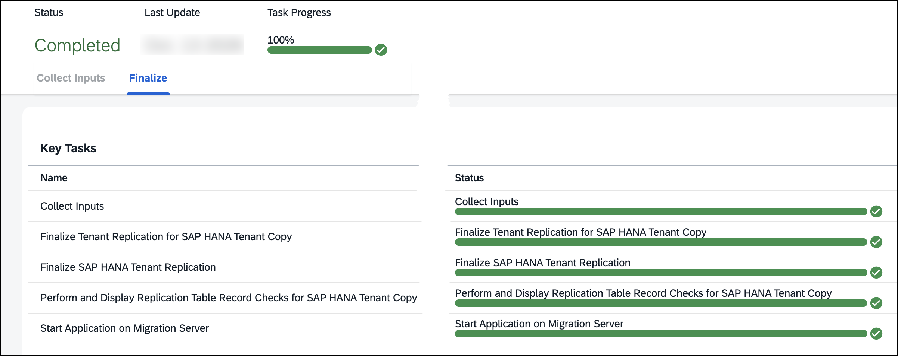 

16. Choose **Confirm and Continue** to return to the SAP HANA Tenant Copy Cockpit. 
17. **Congratulations!** You have successfully finalized the **SAP HANA tenant copy** and completed the replication validation activities.   

## Optional: Test Your Knowledge
Run this optional [quiz](https://quiz-app-per8c91o.cfapps.eu10-005.hana.ondemand.com/tm263-berlin/quiz/zctpe5vp) to test your understanding. If you prefer to skip it, continue with the next exercise. 

> **💡 TIP**: To open this link in a new tab, **right-click** and choose **Open Link in New Tab**.
 

## Summary

You have isolated the source application server, finalized <b>SAP HANA tenant replication</b>, and successfully completed the table record count comparisons between the source and target systems.

The <b>SAP HANA tenant copy</b> is now complete, and the application has been started on the <b>Migration Server</b>. The migration remains in the <b>Downtime</b> phase while the remaining post-processing activities are performed.

Continue to [Exercise 5 - Complete Migration Post-Processing](../ex5/README.md)