# Exercise 5 - Complete Migration Post-Processing

In this exercise, you will complete the <b>Post-Processing</b> activities for the <b>SAP HANA tenant copy</b> using the <b>RISE with SAP System Transition Workbench</b>. You will run the remaining <b>Guided Transition Checks</b> on the <b>Intermediate System</b>, shut down the intermediate SAP application, and review the simulated <b>ECS handover</b> activities before the final switch to the main instance.
 

## Steps:
Follow these steps to complete the exercise: 
1.  In the **SAP HANA Tenant Copy Cockpit**, under **Downtime**, select **Task 2.1 – Post-Processing for SAP HANA Tenant Copy**.  
    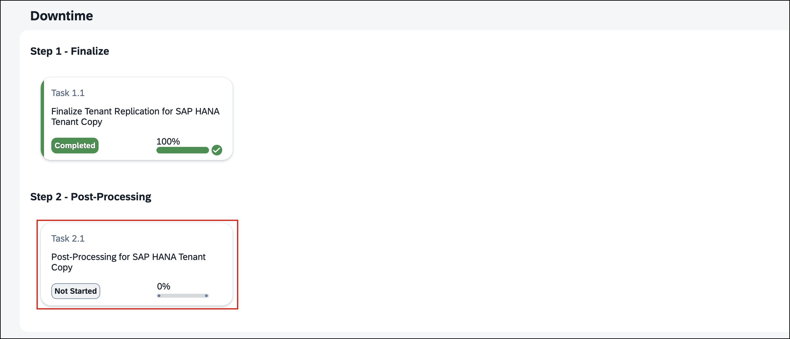 

2.  In the **Confirm Task Initiation** dialog, choose **Start**. 
3.  The workbench starts the **Collect Inputs** phase and retrieves the required system parameters and connection details. 
4.  On the **Parameter Summary** page, review the preconfigured values. Leave **Change Parameter Values** unchecked and choose **Next** to continue with the existing configuration.  
    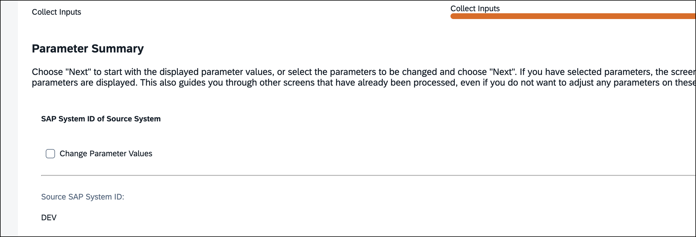 

5.  Review the listed **Post-Processing** activities. These optional activities are not required in our prepared hands-on environment. Select the **confirmation checkbox** and choose **Next** to proceed.  
    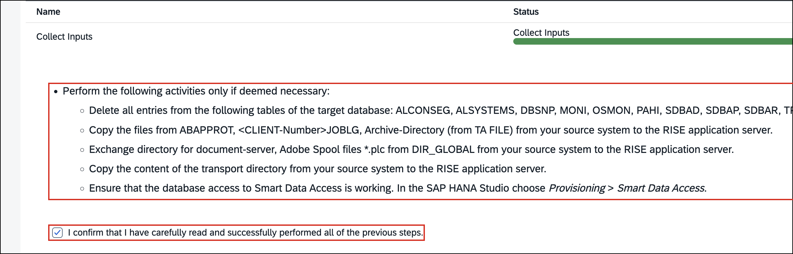 

6.  The workbench requests confirmation that the latest **Guided Transition Checks**, as described in **SAP Note 3409764**, have been implemented. Choose **OK** to continue. The checks will now run on the **Intermediate System**.  
    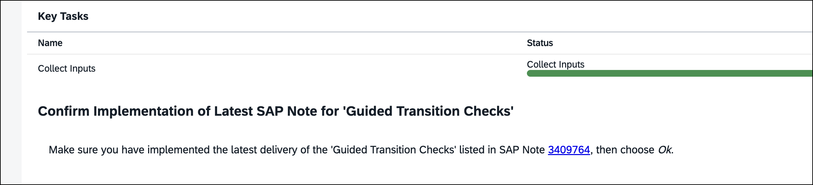 

7.  The workbench executes the **Guided Transition Checks** on the **Intermediate System**. Review the results and verify that only the previously investigated **Pool/Cluster Table Check** remains as a **Non-Blocking Error**.  
    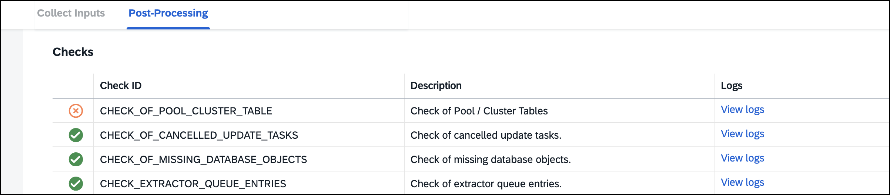 

8.  Once the expected results have been verified, select the **confirmation checkbox** to acknowledge the remaining **Non-Blocking Error**, then choose **Next** to continue.  
    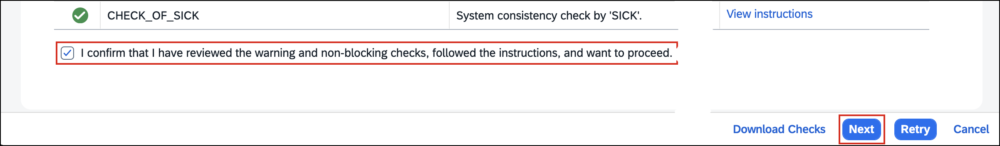 

9.  The workbench automatically restarts the **Intermediate System**. This may take a few minutes. Wait until the restart is complete. 
10. The workbench displays the remaining **Post-Processing** activities, including shutting down the **Intermediate System** and preparing the subsequent **ECS handover**. 

    > **ℹ️ NOTE**: During this hands-on session, you will shut down the **Intermediate System** using Lab Control. The subsequent **ECS handover** steps are simulated; no actual ECS service request is required.

    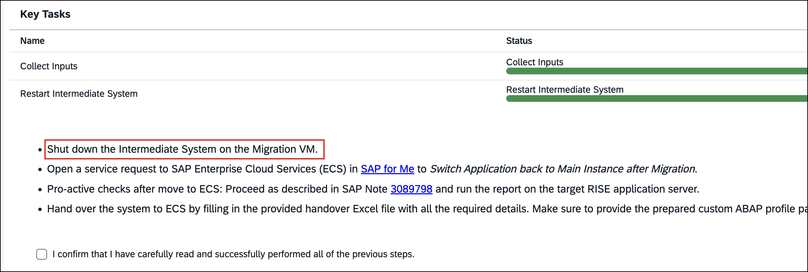 

11. Open the [Lab Control](https://control.lab.consarea.com/intermediate-shutdown) and locate the **Shut Down the Intermediate System** section. Verify the hostname, then choose **Shut Down Intermediate System**.  

    > **⚠️ CAUTION**: Before shutting down the **Intermediate System**, verify that the displayed hostname matches your assigned **seat number** (for example, `migration-001.lab.internal` for seat `001`). **Do not proceed if the hostname does not match!**

     

    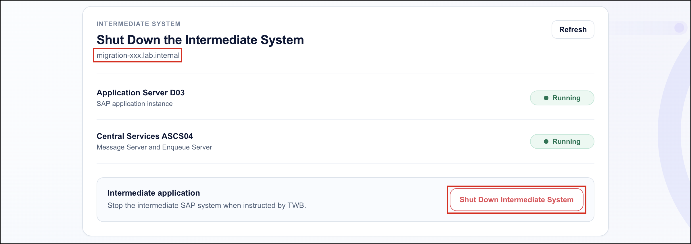 

12. Wait until the **Application Server D03** and **Central Services ASCS04** both have the status **Stopped**. Verify that the shutdown activity has completed successfully.  
    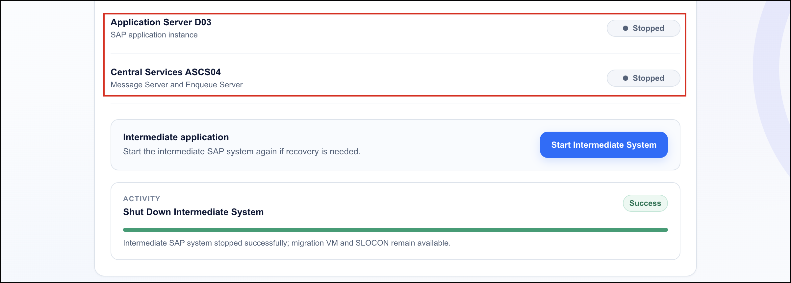 

13. Return to the **System Transition Workbench**. After completing the shutdown and reviewing the simulated ECS handover activities, select the **confirmation checkbox** and choose **Next** to continue.  
    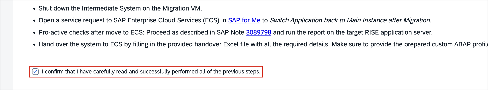 

14. Verify that the workbench shows **100% task progress** and that the displayed key tasks have completed successfully. If the overall task status still shows **In Progress**, wait until the workbench confirms completion before continuing.  
    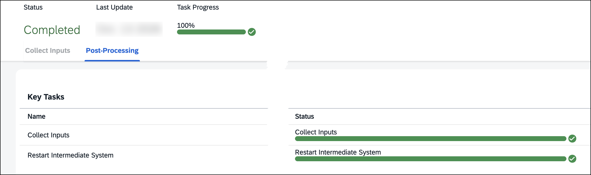 

15. Once the post-processing task has finished, choose **Confirm and Continue** to return to the **SAP HANA Tenant Copy Cockpit**. 
16. **Congratulations!** You have completed the **Post-Processing** activities and prepared the environment for the final switch to the main instance.   

## Optional: Test Your Knowledge
Run this optional [quiz](https://quiz-app-per8c91o.cfapps.eu10-005.hana.ondemand.com/tm263-berlin/quiz/8bcwsys5) to test your understanding. If you prefer to skip it, continue with the next exercise. 

> **💡 TIP**: To open this link in a new tab, **right-click** and choose **Open Link in New Tab**.
 

## Summary

You have completed the <b>Post-Processing</b> activities for the SAP HANA tenant copy, reviewed the <b>Guided Transition Checks</b> on the <b>Intermediate System</b>, and successfully shut down the intermediate SAP application. The <b>ECS handover</b> activities were simulated for this hands-on session.

The migration remains in the <b>Downtime</b> phase. You are now ready to proceed with the final transition to the <b>Main Instance</b> in Exercise 6.

Continue to [Exercise 6 - Switch to the Main Instance](../ex6/README.md)
