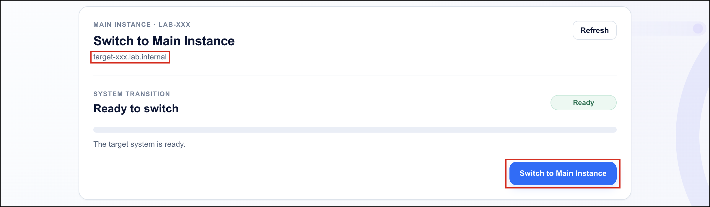
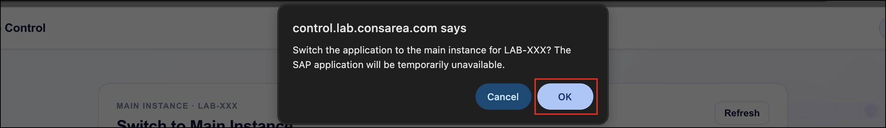
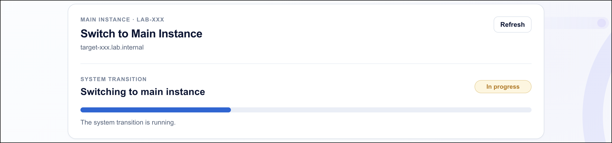
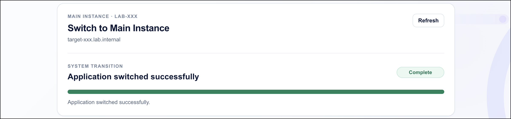
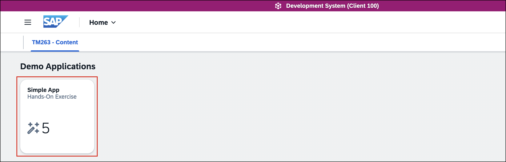
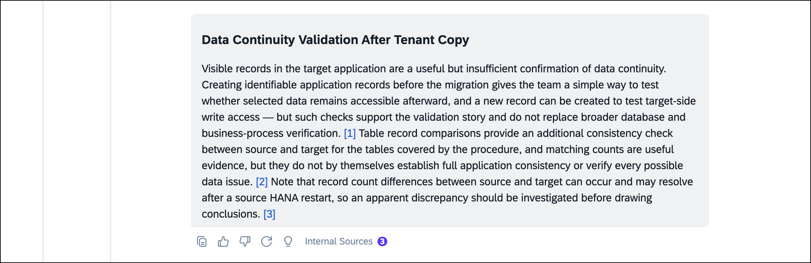
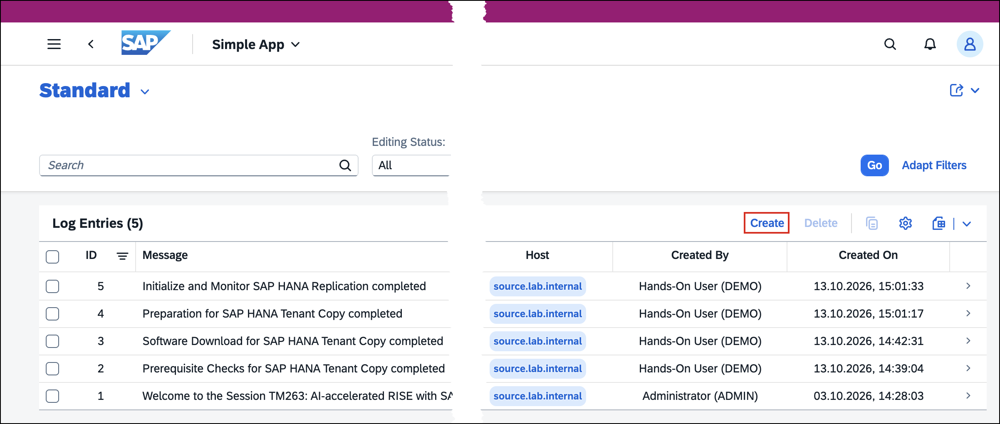
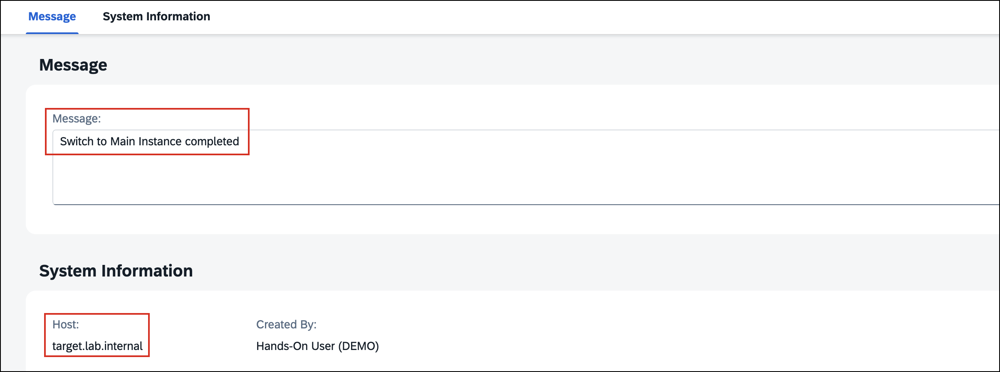
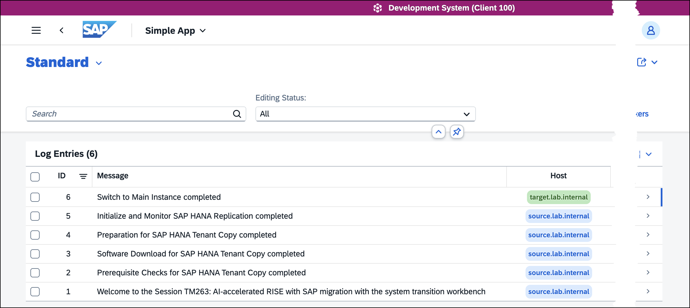

# Exercise 6 - Switch to the Main Instance

<p align="justify">In this exercise, you will switch the SAP application to the <b>Main Instance</b> on the target system and verify that it is accessible after the switchover. You will validate <b>data continuity</b> by reviewing the records created on the source system and adding a new entry in the <b>Simple App</b> on the target system.</p><br>

## Steps:
Follow these steps to complete the exercise:<br>

1.  Open the [Lab Control](https://control.lab.consarea.com/target-switchover) for your target system. Under **Switch to Main Instance**, verify that the status is **Ready** and choose **Switch to Main Instance**.<br><br>

    > **⚠️ CAUTION**: Before proceeding, verify that the displayed **target hostname** matches your assigned **seat number** (for example, `target-001.lab.internal` for seat `001`). **Do not proceed if the hostname does not match!** You could accidentally switch another participant's system. Contact your instructor if you are unsure.

    <br>

    <br>

2.  In the browser confirmation dialog, choose **OK** to initiate the switch. The SAP application may be temporarily unavailable during this operation.<br><br>
    <br>

3.  The system begins switching the SAP application to the **Main Instance**. Wait while the status is **In Progress**.<br><br>
    <br>

4.  Verify that the system displays **Application switched successfully** with the status **Complete** before proceeding.<br><br>
    <br>

5.  Open the **SAP Fiori Launchpad** on the target system using the `target-fiori.url` shortcut included in your connection package.<br>

6.  Log on as user `DEMO` with the **master password** provided for your hands-on session.<br>

7.  Under **TM263 - Content**, open the **Simple App**.<br><br>
    <br>

8.  Review the existing **Log Entries**. Verify that all **five records** from the source system are available on the target system, including the welcome message and the four migration milestones.<br>

9.  Return to your [Joule for Consultants](https://twb-5o5qcjut.eu10.sapj4c.cloud.sap/dashboard/joule) chat and make sure the **Migration Expert** is active.<br>

    > **💡 TIP**: To open this link in a new tab, **right-click** and choose **Open Link in New Tab**.

10. Ask the following question:<br>

    ```text
    The five existing records are visible in the target application after the migration. Is that enough to 
    confirm data continuity, or what else should we validate?
    ```

11. Joule processes your question, which may take a moment. Once the response appears, **review the technical guidance**.<br><br>
    <br>

12. Joule explains that the five existing records show that **selected historical application data** remains accessible on the target system, but this alone does not verify **write access**. Creating a new entry provides an additional check that the **Simple App** can save new data. These application-level checks do not replace broader database and business-process validation.<br>

13.  Choose **Create** to add a new entry.<br><br>
    <br>

14. In the **Message** field, enter the following text:<br>
    ```text
    Switch to Main Instance completed
    ```

15. Verify that the **Host** identifies the target system (`target.lab.internal`) and choose **Create** to save the entry.<br><br>
    <br>

16. Verify that the **Log Entries** list now contains **six records**. The five existing entries still reference the source system, while the new entry references the target system. This demonstrates that existing application records remain available and new records can be created after the switchover.<br><br>
    <br>

17. **Congratulations!** You have successfully switched to the **Main Instance**, verified that the SAP Fiori application is accessible, and validated data continuity using the **Simple App**.<br><br><br>

## Optional: Test Your Knowledge
Run this optional [quiz](https://quiz-app-per8c91o.cfapps.eu10-005.hana.ondemand.com/tm263-berlin/quiz/k8fn6h6k) to test your understanding. If you prefer to skip it, continue with the **Summary** below.<br>

> **💡 TIP**: To open this link in a new tab, **right-click** and choose **Open Link in New Tab**.
<br>

## Summary
<p align="justify">You have successfully switched the SAP application to the <b>Main Instance</b> on the target system and verified that it is accessible through the <b>SAP Fiori Launchpad</b>. All five records created before the switchover remain available in the <b>Simple App</b>, and a sixth record has been created on the target system.</p>

<p align="justify">This completes the <b>TM263 hands-on migration journey</b>: from prerequisite checks and software preparation through SAP HANA tenant replication, downtime processing, and the final application switchover. The retained source-system records and the new target-system entry provide a visible demonstration of application-level data continuity.</p>
